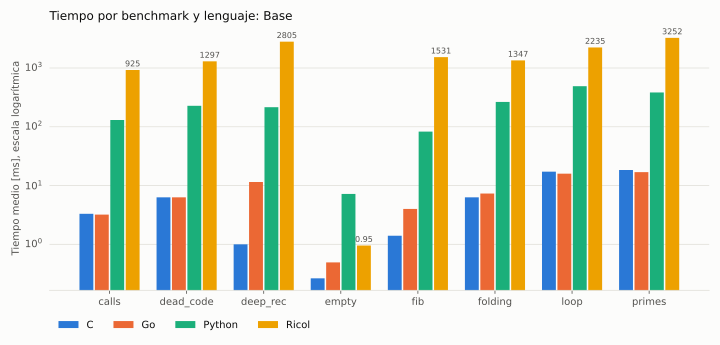
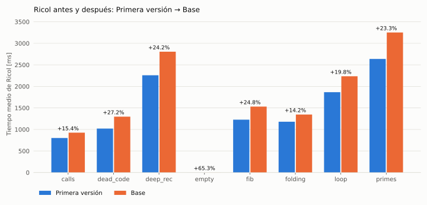

# Resultados de los benchmarks - Versión base

Registro de una corrida de `make bench` con la versión de Ricol previa a las
optimizaciones (commit `27be695a931c1f273bf7cf7f65f4da95cc23a919`). Es el punto
de partida contra el que se comparan las optimizaciones aplicadas al lenguaje.

Se midió en la misma sesión que la [primera versión](results_first_version.md),
una corrida detrás de la otra, para que las dos se puedan comparar.

## Lenguajes

| Lenguaje | Implementación | Versión y compilación |
| :--- | :--- | :--- |
| C | GCC (compilador a código nativo) | gcc (Debian 14.2.0-19) 14.2.0, target `x86_64-linux-gnu`, flags `-O2`, glibc 2.41 |
| Go | gc (compilador oficial a código nativo) | go1.27.4 linux/amd64, `GOAMD64=v1`, `go build` sin flags |
| Python | Intérprete de bytecode | CPython 3.13.5, compilado con GCC 14.2.0; JIT: no; GIL: sí |
| Ricol | Intérprete tree-walking escrito en Go | compilado con el mismo Go que la fila anterior |

## Entorno

- CPU: Intel(R) Core(TM) Ultra 7 155H, núcleos asignados: 1
- Kernel: Linux 7.0.0-43-generic, contenedor Docker, Debian GNU/Linux 13 (trixie)
- hyperfine 1.19.0, con 2 corridas de calentamiento y 10 corridas medidas por programa, sin shell intermedio (`--shell=none`)

## Resumen

## calls

| Command | Mean [ms] | Min [ms] | Max [ms] | Relative |
| :--- | ---: | ---: | ---: | ---: |
| `C` | 3.3 ± 0.1 | 3.3 | 3.5 | 1.03 ± 0.04 |
| `Go` | 3.2 ± 0.1 | 3.1 | 3.3 | 1.00 |
| `Python` | 130.2 ± 4.9 | 125.0 | 137.6 | 40.69 ± 1.99 |
| `Ricol` | 924.9 ± 11.2 | 912.4 | 952.2 | 289.03 ± 9.69 |

## dead_code

| Command | Mean [ms] | Min [ms] | Max [ms] | Relative |
| :--- | ---: | ---: | ---: | ---: |
| `C` | 6.3 ± 0.1 | 6.2 | 6.6 | 1.00 |
| `Go` | 6.3 ± 0.1 | 6.2 | 6.4 | 1.00 ± 0.02 |
| `Python` | 227.1 ± 5.6 | 221.4 | 239.1 | 36.05 ± 1.06 |
| `Ricol` | 1297.0 ± 4.0 | 1290.0 | 1304.0 | 205.87 ± 3.33 |

## deep_rec

| Command | Mean [ms] | Min [ms] | Max [ms] | Relative |
| :--- | ---: | ---: | ---: | ---: |
| `C` | 1.0 ± 0.0 | 0.9 | 1.0 | 1.00 |
| `Go` | 11.5 ± 0.1 | 11.2 | 11.6 | 11.98 ± 0.32 |
| `Python` | 215.3 ± 1.9 | 212.3 | 218.2 | 224.20 ± 5.99 |
| `Ricol` | 2805.0 ± 54.0 | 2722.0 | 2872.0 | 2920.96 ± 92.63 |

## empty

| Command | Mean [µs] | Min [µs] | Max [µs] | Relative |
| :--- | ---: | ---: | ---: | ---: |
| `C` | 263.9 ± 24.3 | 246.4 | 326.5 | 1.00 |
| `Go` | 492.8 ± 40.4 | 447.8 | 561.2 | 1.87 ± 0.23 |
| `Python` | 7200.0 ± 100.0 | 7100.0 | 7300.0 | 27.28 ± 2.54 |
| `Ricol` | 952.2 ± 72.2 | 858.8 | 1054.9 | 3.61 ± 0.43 |

## fib

| Command | Mean [ms] | Min [ms] | Max [ms] | Relative |
| :--- | ---: | ---: | ---: | ---: |
| `C` | 1.4 ± 0.1 | 1.4 | 1.5 | 1.00 |
| `Go` | 4.0 ± 0.1 | 3.9 | 4.1 | 2.86 ± 0.22 |
| `Python` | 82.8 ± 1.0 | 81.7 | 84.4 | 59.14 ± 4.28 |
| `Ricol` | 1531.0 ± 8.0 | 1523.0 | 1549.0 | 1093.57 ± 78.32 |

## folding

| Command | Mean [ms] | Min [ms] | Max [ms] | Relative |
| :--- | ---: | ---: | ---: | ---: |
| `C` | 6.3 ± 0.1 | 6.1 | 6.4 | 1.00 |
| `Go` | 7.3 ± 0.1 | 7.1 | 7.5 | 1.16 ± 0.02 |
| `Python` | 264.6 ± 2.8 | 261.6 | 269.4 | 42.00 ± 0.80 |
| `Ricol` | 1347.0 ± 5.0 | 1339.0 | 1354.0 | 213.81 ± 3.49 |

## loop

| Command | Mean [ms] | Min [ms] | Max [ms] | Relative |
| :--- | ---: | ---: | ---: | ---: |
| `C` | 17.2 ± 0.5 | 16.3 | 18.0 | 1.08 ± 0.04 |
| `Go` | 15.9 ± 0.4 | 15.5 | 16.4 | 1.00 |
| `Python` | 489.6 ± 11.1 | 475.3 | 507.9 | 30.79 ± 1.04 |
| `Ricol` | 2235.0 ± 13.0 | 2224.0 | 2269.0 | 140.57 ± 3.63 |

## primes

| Command | Mean [ms] | Min [ms] | Max [ms] | Relative |
| :--- | ---: | ---: | ---: | ---: |
| `C` | 18.4 ± 0.6 | 17.6 | 19.4 | 1.09 ± 0.04 |
| `Go` | 16.9 ± 0.3 | 16.7 | 17.5 | 1.00 |
| `Python` | 383.1 ± 8.3 | 374.3 | 404.5 | 22.67 ± 0.63 |
| `Ricol` | 3252.0 ± 37.0 | 3205.0 | 3327.0 | 192.43 ± 4.06 |

## Comparación con la primera versión

| Benchmark | Primera versión | Versión base | Cambio |
| :--- | ---: | ---: | ---: |
| `calls` | 801.2 ms | 924.9 ms | +15.4% |
| `dead_code` | 1020.0 ms | 1297.0 ms | +27.2% |
| `deep_rec` | 2258.0 ms | 2805.0 ms | +24.2% |
| `empty` | 0.58 ms | 0.95 ms | +65.3% |
| `fib` | 1227.0 ms | 1531.0 ms | +24.8% |
| `folding` | 1179.0 ms | 1347.0 ms | +14.2% |
| `loop` | 1865.0 ms | 2235.0 ms | +19.8% |
| `primes` | 2637.0 ms | 3252.0 ms | +23.3% |

Desde la primera entrega, Ricol se volvió entre 14% y 27% más lento en todos
los benchmarks, sin que ninguno de ellos use las funcionalidades agregadas
desde entonces (structs, enums, imports, servicios y sesiones).

### Por qué: environments con el doble de maps

La causa principal está en `newEnvironment`. En la primera versión, cada
environment tenía 2 maps (`values` y `functions`); para soportar structs y
enums se agregaron otros 2 (`structs` y `enums`). Como se crea un environment
nuevo en cada bloque y en cada llamada a función, cada iteración de un loop
ahora reserva el doble de maps, aunque el programa no declare ningún struct ni
enum.

Los perfiles de las dos versiones lo confirman. Segundos de CPU de cada
función, contando lo que llama:

| Función | `loop`, primera versión | `loop`, base | `fib`, primera versión | `fib`, base |
| :--- | ---: | ---: | ---: | ---: |
| `newEnvironment` | 0.29 s | 0.66 s | 0.21 s | 0.57 s |
| Creación de maps (`makemap_small`) | 0.18 s | 0.54 s | 0.15 s | 0.43 s |
| Recolector de basura | 0.08 s | 0.19 s | 0.16 s | 0.45 s |

Más maps también significa más trabajo para el recolector de basura, que en
`fib` casi se triplica. `dead_code` es el que más empeora (+27%): cada
iteración crea dos environments (el del cuerpo del `while` y el del bloque del
`if` que se cumple), y el resto de la iteración es corto, así que los
environments pesan más en su tiempo total que en `loop`.

### El arranque

`empty` pasó de 0.58 ms a 0.95 ms. El intérprete ahora incluye los paquetes de
red de Go (`net` y sus dependencias) para los services y las sessions. El tiempo
de inicialización de los paquetes casi no cambió (0.15 ms contra 0.18 ms, medido
con `GODEBUG=inittrace=1`), así que la diferencia está en cargar un binario más
grande. Igual, sigue siendo casi 8 veces más rápido que el arranque de CPython
(7.2 ms).

## Conclusiones

### Ricol frente a Python

Ricol es entre 4.6 y 18.5 veces más lento que CPython:

| Benchmark | Ricol / Python | Primera versión |
| :--- | ---: | ---: |
| `loop` | 4.6× | 3.8× |
| `folding` | 5.1× | 4.4× |
| `dead_code` | 5.7× | 4.4× |
| `calls` | 7.1× | 6.0× |
| `primes` | 8.5× | 6.9× |
| `deep_rec` | 13.0× | 10.2× |
| `fib` | 18.5× | 14.8× |

Sin contar el arranque, una iteración de `loop` cuesta unos 450 ns (370 ns en
la primera versión, 96 ns en Python), y una llamada de `fib` unos 570 ns
(455 ns en la primera versión, 28 ns en Python).

### Dónde se va el tiempo ahora

Porcentaje de las muestras de CPU de cada función, contando lo que llama
(perfiles tomados con `--cpuprofile`, fuera de Docker):

| Punto caliente | `loop` | `fib` | Optimización a aplicar que lo ataca |
| :--- | ---: | ---: | :--- |
| `newEnvironment` (4 maps por bloque y por llamada) | 22% | 23% | Crear los maps de forma _lazy_ |
| Creación de maps (`makemap_small`, dentro de la anterior) | 18% | 18% | Crear los maps de forma _lazy_ |
| `distanceOf` (`map[Expression]int`) | 20% | 6% | Distancia guardada en el nodo |
| Recolector de basura | 6% | 18% | Crear los maps de forma _lazy_ |
| Paso de `Number` a la interfaz `Value` (`convTnoptr`) | 11% | 2% | Ninguna |
| `errors.As` para detectar el `return` | — | 9% | Return sin `errors.As` |

De esta forma, tenemos una perspectiva de qué optimizaciones conviene aplicar
para lograr un inpacto significativo en el rendimiento del lenguaje.

### Limitaciones

- Todas las mediciones son de una sola máquina, usando un solo núcleo dentro
  de Docker. Los tiempos absolutos cambian entre máquinas; las proporciones
  entre lenguajes son más estables.
- CPython 3.13 corre sin JIT. Con PyPy u otro intérprete con JIT, la
  comparación contra Python cambiaría mucho.
- `deep_rec` usa profundidades menores a 10000 porque ese es el límite de
  llamadas anidadas de Ricol (`maxCallDepth`). No mide recursiones más
  profundas en ningún lenguaje.
- Los perfiles se tomaron fuera de Docker, sin limitar los núcleos. Sirven
  para comparar el peso de cada función, no los tiempos absolutos.
