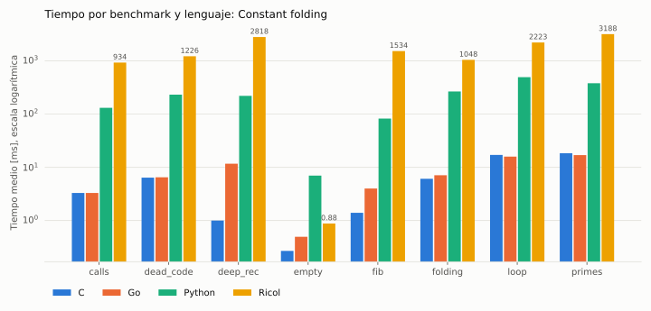
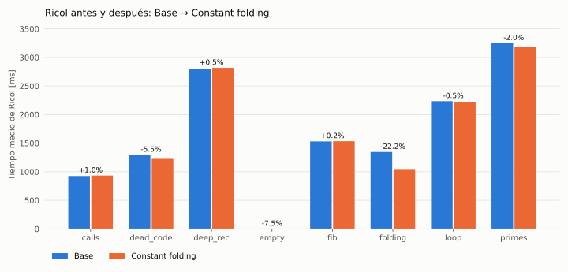

# Resultados de los benchmarks - Constant folding

Registro de una corrida de `make bench` después de agregar constant folding a
Ricol (commit `1cd33f61a4116621b7afcb37c8313d6bcd9c13bf`). Es la primera
optimización aplicada, que se compara contra la
[versión base](results_baseline.md).

## La optimización

**Constant folding** consiste en calcular, antes de ejecutar el programa, las
expresiones cuyos operandos son todos literales, y reemplazarlas por su
resultado. Si una expresión como `60 * 60 * 24` está dentro de un loop, sin la
optimización el intérprete la vuelve a calcular en cada iteración; con la
optimización, el cálculo se hace una sola vez y el loop solo lee el literal
`86400`.

Ricol ahora tiene una fase nueva, el **optimizador**, que corre después del
typechecker y antes del intérprete. El flag `--optimize` muestra el programa
tal como queda después de esa fase. Por ejemplo, el loop del benchmark
`folding`:

```ricol
while (i < 2000 * 1000) {
    acc = (acc + i * (60 * 60 * 24) + (1000 - 7 * 3) - -5) % 1000003;
    i = i + 1;
}
```

queda así (salida de `--optimize`):

```plaintext
while ((i LESS<<> INTEGER<2000000>)) {
  (acc = (((((acc PLUS<+> (i STAR<*> INTEGER<86400>)) PLUS<+> INTEGER<979>) MINUS<-> INTEGER<-5>)) PERCENTAGE<%> INTEGER<1000003>));
  (i = (i PLUS<+> INTEGER<1>));
}
```

Qué se pliega, de abajo hacia arriba:

| Expresión | Resultado |
| :--- | :--- |
| Binaria con los dos operandos literales (`2000 * 1000`, `"a" + "b"`, `1 < 2`) | El literal con el resultado |
| Unaria con operando literal (`-5`, `not True`) | El literal: `-5` deja de ser una resta en cada ejecución |
| Paréntesis alrededor de un literal (`(979)`) | El literal |
| `False and x`, `True or x` | El literal izquierdo, porque `x` nunca se evalúa |
| `True and x`, `False or x` | `x` |

Para que el resultado sea idéntico al de la ejecución, el optimizador no
reimplementa los operadores: le pide al propio intérprete que evalúe la
expresión. Así se respetan la división entera hacia abajo, el desborde de los
enteros y las reglas entre `Int` y `Float`.

Lo que **no** se pliega:

- **Las operaciones que fallan**, como `1 / 0` o `2 ** -1`, quedan como están,
  para que el error siga ocurriendo al ejecutar y con la misma posición.
- **Las cuentas que mezclan variables y literales sin paréntesis**: `x + 1 + 2`
  se lee como `(x + 1) + 2`, y ninguna de las dos sumas tiene ambos operandos
  literales. Plegarla exigiría reordenar las operaciones, que no es seguro en
  general con floats.

Para comparar esta optimización, se agregó el benchmark `folding`, que tiene
expresiones constantes en la condición y en el cuerpo del loop. Los benchmarks
originales no tienen expresiones constantes, así que no deberían cambiar.

## Lenguajes

| Lenguaje | Implementación | Versión y compilación |
| :--- | :--- | :--- |
| C | GCC (compilador a código nativo) | gcc (Debian 14.2.0-19) 14.2.0, target `x86_64-linux-gnu`, flags `-O2`, glibc 2.41 |
| Go | gc (compilador oficial a código nativo) | go1.27.4 linux/amd64, `GOAMD64=v1`, `go build` sin flags |
| Python | Intérprete de bytecode | CPython 3.13.5, compilado con GCC 14.2.0; JIT: no; GIL: sí |
| Ricol | Intérprete tree-walking escrito en Go | compilado con el mismo Go que la fila anterior |

## Entorno

- CPU: Intel(R) Core(TM) Ultra 7 155H, núcleos asignados: 1
- Kernel: Linux 7.0.0-43-generic, contenedor Docker, Debian GNU/Linux 13 (trixie)
- hyperfine 1.19.0, con 2 corridas de calentamiento y 10 corridas medidas por programa, sin shell intermedio (`--shell=none`)

## Resumen



## calls

| Command | Mean [ms] | Min [ms] | Max [ms] | Relative |
| :--- | ---: | ---: | ---: | ---: |
| `C` | 3.3 ± 0.0 | 3.3 | 3.4 | 1.00 |
| `Go` | 3.3 ± 0.1 | 3.2 | 3.6 | 1.00 ± 0.03 |
| `Python` | 131.4 ± 4.8 | 123.6 | 137.1 | 39.82 ± 1.45 |
| `Ricol` | 933.7 ± 11.0 | 918.0 | 959.1 | 282.94 ± 3.33 |

## dead_code

| Command | Mean [ms] | Min [ms] | Max [ms] | Relative |
| :--- | ---: | ---: | ---: | ---: |
| `C` | 6.4 ± 0.1 | 6.3 | 6.6 | 1.00 |
| `Go` | 6.5 ± 0.1 | 6.4 | 6.6 | 1.02 ± 0.02 |
| `Python` | 232.7 ± 5.8 | 226.0 | 245.4 | 36.36 ± 1.07 |
| `Ricol` | 1226.0 ± 6.0 | 1217.0 | 1235.0 | 191.56 ± 3.14 |

## deep_rec

| Command | Mean [ms] | Min [ms] | Max [ms] | Relative |
| :--- | ---: | ---: | ---: | ---: |
| `C` | 1.0 ± 0.0 | 0.9 | 1.1 | 1.00 |
| `Go` | 11.7 ± 0.3 | 11.3 | 12.2 | 11.86 ± 0.58 |
| `Python` | 220.7 ± 2.2 | 217.6 | 225.5 | 223.74 ± 9.56 |
| `Ricol` | 2818.0 ± 40.0 | 2720.0 | 2853.0 | 2856.85 ± 125.48 |

## empty

| Command | Mean [µs] | Min [µs] | Max [µs] | Relative |
| :--- | ---: | ---: | ---: | ---: |
| `C` | 269.2 ± 35.7 | 245.0 | 359.7 | 1.00 |
| `Go` | 496.0 ± 42.7 | 454.2 | 583.2 | 1.84 ± 0.29 |
| `Python` | 7000.0 ± 100.0 | 7000.0 | 7100.0 | 26.00 ± 3.47 |
| `Ricol` | 880.4 ± 50.8 | 835.8 | 1006.5 | 3.27 ± 0.47 |

## fib

| Command | Mean [ms] | Min [ms] | Max [ms] | Relative |
| :--- | ---: | ---: | ---: | ---: |
| `C` | 1.4 ± 0.0 | 1.4 | 1.4 | 1.00 |
| `Go` | 4.0 ± 0.1 | 4.0 | 4.2 | 2.86 ± 0.07 |
| `Python` | 82.6 ± 0.6 | 81.7 | 83.8 | 59.00 ± 0.43 |
| `Ricol` | 1534.0 ± 8.0 | 1521.0 | 1545.0 | 1095.71 ± 5.71 |

## folding

| Command | Mean [ms] | Min [ms] | Max [ms] | Relative |
| :--- | ---: | ---: | ---: | ---: |
| `C` | 6.1 ± 0.1 | 6.0 | 6.2 | 1.00 |
| `Go` | 7.1 ± 0.1 | 7.0 | 7.3 | 1.16 ± 0.03 |
| `Python` | 266.9 ± 5.1 | 260.7 | 274.2 | 43.75 ± 1.10 |
| `Ricol` | 1048.0 ± 3.0 | 1044.0 | 1055.0 | 171.80 ± 2.86 |

## loop

| Command | Mean [ms] | Min [ms] | Max [ms] | Relative |
| :--- | ---: | ---: | ---: | ---: |
| `C` | 17.1 ± 0.5 | 16.3 | 18.0 | 1.08 ± 0.04 |
| `Go` | 15.9 ± 0.3 | 15.5 | 16.3 | 1.00 |
| `Python` | 496.1 ± 11.3 | 481.0 | 521.4 | 31.20 ± 0.92 |
| `Ricol` | 2223.0 ± 5.0 | 2213.0 | 2230.0 | 139.81 ± 2.66 |

## primes

| Command | Mean [ms] | Min [ms] | Max [ms] | Relative |
| :--- | ---: | ---: | ---: | ---: |
| `C` | 18.4 ± 0.6 | 17.5 | 19.3 | 1.08 ± 0.04 |
| `Go` | 17.0 ± 0.3 | 16.6 | 17.5 | 1.00 |
| `Python` | 381.3 ± 6.4 | 374.9 | 397.1 | 22.43 ± 0.55 |
| `Ricol` | 3188.0 ± 13.0 | 3174.0 | 3208.0 | 187.53 ± 3.40 |

## Comparación con la versión base



| Benchmark | Versión base | Constant folding | Cambio |
| :--- | ---: | ---: | ---: |
| `calls` | 924.9 ms | 933.7 ms | +1.0% |
| `dead_code` | 1297.0 ms | 1226.0 ms | -5.5% |
| `deep_rec` | 2805.0 ms | 2818.0 ms | +0.5% |
| `empty` | 0.95 ms | 0.88 ms | -7.5% |
| `fib` | 1531.0 ms | 1534.0 ms | +0.2% |
| `folding` | 1347.0 ms | 1048.0 ms | **-22.2%** |
| `loop` | 2235.0 ms | 2223.0 ms | -0.5% |
| `primes` | 3252.0 ms | 3188.0 ms | -2.0% |

Como se esperaba, solo cambian los dos benchmarks con expresiones constantes.
Las demás diferencias están dentro de la variación entre corridas: en `empty`,
el desvío de cada medición es de un 5% a 8% y el optimizador hace más lento el
arranque, porque agrega una fase.

### Por qué `folding` mejora un 22%

El intérprete evalúa el AST nodo por nodo, y cada nodo cuesta lo mismo sin
importar si es una suma o un literal. Contando los nodos de expresión que
evalúa cada iteración de `folding`:

| Parte de la iteración | Versión base | Constant folding |
| :--- | ---: | ---: |
| Condición del `while` | 5 | 3 |
| `acc = ...` | 24 | 13 |
| `i = i + 1` | 4 | 4 |
| **Total** | **33** | **20** |

Cada iteración evalúa un 39% menos de nodos, pero el tiempo baja un 22%. La
diferencia está en el costo fijo de cada iteración que el folding no toca:
crear el environment del cuerpo del `while`, despachar las sentencias y buscar
las variables.

## Conclusiones

### Ricol frente a Python

| Benchmark | Ricol / Python | Versión base |
| :--- | ---: | ---: |
| `folding` | 3.9× | 5.1× |
| `loop` | 4.5× | 4.6× |
| `dead_code` | 5.3× | 5.7× |
| `calls` | 7.1× | 7.1× |
| `primes` | 8.4× | 8.5× |
| `deep_rec` | 12.8× | 13.0× |
| `fib` | 18.6× | 18.5× |

### Dónde se va el tiempo ahora

Los perfiles de `loop` y `fib` son prácticamente los mismos que en la
[versión base](results_baseline.md#dónde-se-va-el-tiempo-ahora), porque esos
benchmarks no tienen expresiones constantes. `newEnvironment` sigue siendo el
punto más caro (23% de `loop` y 29% de `fib`), seguido por `distanceOf` en
`loop` (19%).

### Limitaciones

- Todas las mediciones son de una sola máquina, usando un solo núcleo dentro
  de Docker. Los tiempos absolutos cambian entre máquinas; las proporciones
  entre lenguajes son más estables.
- Los perfiles se tomaron fuera de Docker, sin limitar los núcleos. Sirven
  para comparar el peso de cada función, no los tiempos absolutos.
