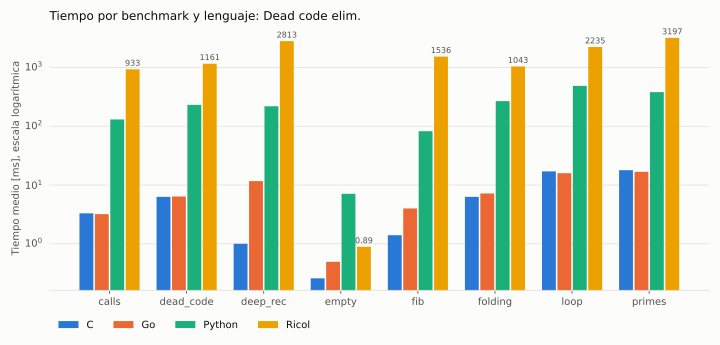
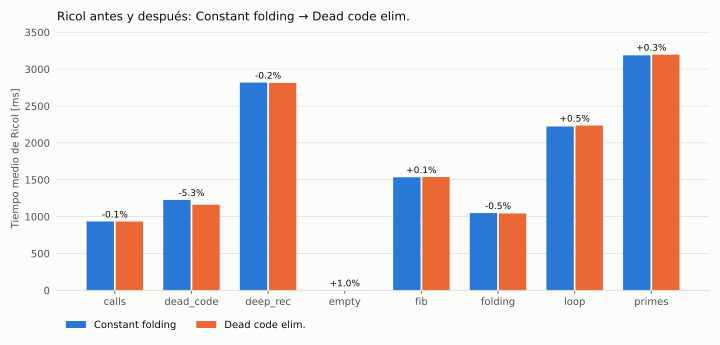

# Resultados de los benchmarks - Dead code elimination

Registro de una corrida de `make bench` después de agregar dead code
elimination al optimizador de Ricol (commit
`99fd397d6554b3479b0927093b259eed66ff3a86`). Es la segunda optimización
implementada, y se compara contra la versión con
[constant folding](results_constant_folding.md).

## La optimización

**Dead code elimination** (DCE) consiste en eliminar, antes de ejecutar el
programa, el código que nunca se va a ejecutar o cuyo resultado no se usa. En
Ricol se eliminan dos tipos de código:

- **Ramas con condición literal.** Después del constant folding, una condición
  como `1 > 2` queda como el literal `False`. Un `if (False)` nunca ejecuta su
  rama, y un `if (True)` siempre la ejecuta, así que evaluar la condición en
  cada pasada es trabajo inútil.
- **Sentencias después de un salto.** Lo que sigue a un `return`, `break` o
  `continue` en el mismo bloque nunca se alcanza.

| Sentencia | Resultado |
| :--- | :--- |
| `if (False) A` | Se elimina |
| `if (False) A else B` | `B` |
| `if (True) A else B` | `A` |
| `while (False) A` | Se elimina |
| Sentencias después de `return`, `break` o `continue` | Se eliminan |

Las ramas que quedan (`A` o `B`) son bloques, y se conservan como bloques: el
scope que calculó el typechecker sigue siendo el mismo, así que las variables
declaradas adentro no se mezclan con las de afuera.

Por ejemplo, el loop del benchmark `dead_code`:

```ricol
while (i < 2000000) {
    if (1 > 2) {
        acc = acc * 2;
    }
    if (2 * 3 == 6) {
        acc = (acc + i) % 1000003;
    } else {
        acc = 0;
    }
    while (False) {
        acc = acc + 1;
    }
    i = i + 1;
}
```

queda así (salida de `--optimize`):

```plaintext
while ((i LESS<<> INTEGER<2000000>)) {
  {
    (acc = (((acc PLUS<+> i)) PERCENTAGE<%> INTEGER<1000003>));
  }
  (i = (i PLUS<+> INTEGER<1>));
}
```

En Ricol no hay constantes y todas las variables se pueden reasignar, así que
la DCE solo encuentra ramas muertas cuando la condición está escrita con
literales, como en este benchmark.

Eliminar las sentencias después de un `return` no cambia el tiempo de
ejecución, porque ese código nunca se ejecuta. Se incluye porque es parte de la
DCE clásica y deja el programa más chico.

**Benchmarks que deberían mejorar**: solo `dead_code`. En el resto, el AST
optimizado es idéntico al de la versión anterior (verificado comparando la
salida de `--optimize`).

## Lenguajes

| Lenguaje | Implementación | Versión y compilación |
| :--- | :--- | :--- |
| C | GCC (compilador a código nativo) | gcc (Debian 14.2.0-19) 14.2.0, target `x86_64-linux-gnu`, flags `-O2`, glibc 2.41 |
| Go | gc (compilador oficial a código nativo) | go1.27.4 linux/amd64, `GOAMD64=v1`, `go build` sin flags |
| Python | Intérprete de bytecode | CPython 3.13.5, compilado con GCC 14.2.0; JIT: no; GIL: sí |
| Ricol | Intérprete tree-walking escrito en Go | compilado con el mismo Go que la fila anterior |

## Entorno

- CPU: Intel(R) Core(TM) Ultra 7 155H, núcleos asignados: 1
- Kernel: Linux 7.0.0-43-generic, contenedor Docker, Debian GNU/Linux 13 (trixie)
- hyperfine 1.19.0, con 2 corridas de calentamiento y 10 corridas medidas por programa, sin shell intermedio (`--shell=none`)

## Resumen



## calls

| Command | Mean [ms] | Min [ms] | Max [ms] | Relative |
| :--- | ---: | ---: | ---: | ---: |
| `C` | 3.3 ± 0.1 | 3.3 | 3.5 | 1.03 ± 0.03 |
| `Go` | 3.2 ± 0.0 | 3.2 | 3.3 | 1.00 |
| `Python` | 130.6 ± 4.9 | 125.6 | 139.9 | 40.81 ± 1.53 |
| `Ricol` | 933.0 ± 9.8 | 922.7 | 950.0 | 291.56 ± 3.06 |

## dead_code

| Command | Mean [ms] | Min [ms] | Max [ms] | Relative |
| :--- | ---: | ---: | ---: | ---: |
| `C` | 6.3 ± 0.1 | 6.2 | 6.4 | 1.00 |
| `Go` | 6.4 ± 0.1 | 6.3 | 6.6 | 1.02 ± 0.02 |
| `Python` | 231.9 ± 9.4 | 225.4 | 257.8 | 36.81 ± 1.60 |
| `Ricol` | 1161.0 ± 8.0 | 1148.0 | 1175.0 | 184.29 ± 3.19 |

## deep_rec

| Command | Mean [ms] | Min [ms] | Max [ms] | Relative |
| :--- | ---: | ---: | ---: | ---: |
| `C` | 1.0 ± 0.0 | 0.9 | 1.1 | 1.00 |
| `Go` | 11.7 ± 0.3 | 11.4 | 12.1 | 12.15 ± 0.65 |
| `Python` | 219.1 ± 1.8 | 216.7 | 221.9 | 227.54 ± 10.91 |
| `Ricol` | 2813.0 ± 42.0 | 2766.0 | 2895.0 | 2921.38 ± 144.77 |

## empty

| Command | Mean [µs] | Min [µs] | Max [µs] | Relative |
| :--- | ---: | ---: | ---: | ---: |
| `C` | 258.7 ± 26.4 | 240.2 | 324.4 | 1.00 |
| `Go` | 493.4 ± 32.1 | 462.0 | 577.1 | 1.91 ± 0.23 |
| `Python` | 7100.0 ± 200.0 | 7000.0 | 7600.0 | 27.44 ± 2.91 |
| `Ricol` | 889.0 ± 43.0 | 848.9 | 963.0 | 3.44 ± 0.39 |

## fib

| Command | Mean [ms] | Min [ms] | Max [ms] | Relative |
| :--- | ---: | ---: | ---: | ---: |
| `C` | 1.4 ± 0.0 | 1.4 | 1.5 | 1.00 |
| `Go` | 4.0 ± 0.0 | 3.9 | 4.0 | 2.86 ± 0.00 |
| `Python` | 82.6 ± 0.9 | 81.3 | 84.0 | 59.00 ± 0.64 |
| `Ricol` | 1536.0 ± 7.0 | 1530.0 | 1550.0 | 1097.14 ± 5.00 |

## folding

| Command | Mean [ms] | Min [ms] | Max [ms] | Relative |
| :--- | ---: | ---: | ---: | ---: |
| `C` | 6.3 ± 0.1 | 6.2 | 6.5 | 1.00 |
| `Go` | 7.2 ± 0.1 | 7.1 | 7.5 | 1.14 ± 0.02 |
| `Python` | 268.2 ± 9.0 | 258.7 | 288.5 | 42.57 ± 1.58 |
| `Ricol` | 1043.0 ± 6.0 | 1031.0 | 1051.0 | 165.56 ± 2.80 |

## loop

| Command | Mean [ms] | Min [ms] | Max [ms] | Relative |
| :--- | ---: | ---: | ---: | ---: |
| `C` | 17.1 ± 0.5 | 16.3 | 18.1 | 1.08 ± 0.04 |
| `Go` | 15.9 ± 0.3 | 15.5 | 16.4 | 1.00 |
| `Python` | 487.5 ± 7.8 | 479.1 | 503.6 | 30.66 ± 0.76 |
| `Ricol` | 2235.0 ± 33.0 | 2213.0 | 2324.0 | 140.57 ± 3.37 |

## primes

| Command | Mean [ms] | Min [ms] | Max [ms] | Relative |
| :--- | ---: | ---: | ---: | ---: |
| `C` | 17.9 ± 0.5 | 17.4 | 18.8 | 1.07 ± 0.03 |
| `Go` | 16.8 ± 0.2 | 16.6 | 17.3 | 1.00 |
| `Python` | 382.0 ± 7.3 | 375.5 | 401.3 | 22.74 ± 0.51 |
| `Ricol` | 3197.0 ± 14.0 | 3176.0 | 3216.0 | 190.30 ± 2.41 |

## Comparación con constant folding



| Benchmark | Constant folding | Dead code elimination | Cambio |
| :--- | ---: | ---: | ---: |
| `calls` | 933.7 ms | 933.0 ms | -0.1% |
| `dead_code` | 1226.0 ms | 1161.0 ms | **-5.3%** |
| `deep_rec` | 2818.0 ms | 2813.0 ms | -0.2% |
| `empty` | 0.88 ms | 0.89 ms | +1.0% |
| `fib` | 1534.0 ms | 1536.0 ms | +0.1% |
| `folding` | 1048.0 ms | 1043.0 ms | -0.5% |
| `loop` | 2223.0 ms | 2235.0 ms | +0.5% |
| `primes` | 3188.0 ms | 3197.0 ms | +0.3% |

Solo cambia `dead_code`; el resto se mueve menos de un 1%, que es el ruido entre
corridas. Contra la [versión base](results_baseline.md), `dead_code` mejoró un
10.5% en total (de 1297 ms a 1161 ms): la mitad por el folding de sus
condiciones y la otra mitad por la DCE.

### Por qué la mejora es chica

Lo que la DCE le saca a cada iteración de `dead_code`:

| Por iteración | Constant folding | Dead code elimination |
| :--- | ---: | ---: |
| Sentencias ejecutadas | 7 | 4 |
| Nodos de expresión evaluados | 17 | 14 |
| Environments creados | 2 | 2 |

Se dejan de ejecutar tres sentencias (los dos `if` y el `while (False)`) y sus
condiciones, que después del folding ya eran literales baratos. Lo que más
cuesta en cada iteración, crear los environments, no cambia: el `if (True)` se
reemplaza por su bloque, y ese bloque sigue creando su environment en cada
pasada. Una optimización adicional que se puede realizar (no implementada
finalmente) es aplanar los bloques que no declaran variables. Esto requeriría
que el typechecker no abra un scope en ellos.

La optimización de crear los maps de los environments de forma perezosa apunta
a conseguir una mejora de rendimiento más significativa.

## Conclusiones

### Ricol frente a Python

| Benchmark | Ricol / Python | Constant folding |
| :--- | ---: | ---: |
| `folding` | 3.9× | 3.9× |
| `loop` | 4.6× | 4.5× |
| `dead_code` | 5.0× | 5.3× |
| `calls` | 7.1× | 7.1× |
| `primes` | 8.4× | 8.4× |
| `deep_rec` | 12.8× | 12.8× |
| `fib` | 18.6× | 18.6× |

### Dónde se va el tiempo ahora

Como el AST de `loop` y `fib` no cambió respecto de la versión anterior, sus
perfiles son los mismos que con
[constant folding](results_constant_folding.md#dónde-se-va-el-tiempo-ahora):
`newEnvironment` sigue siendo el punto más caro, y es lo que ataca la próxima
optimización.

Con este paso terminan las optimizaciones del programa que dependen de
expresiones constantes. Las tres siguientes son del intérprete y deberían
mejorar todos los benchmarks, no solo los que tienen constantes.

### Limitaciones

- Todas las mediciones son de una sola máquina, usando un solo núcleo dentro
  de Docker. Los tiempos absolutos cambian entre máquinas; las proporciones
  entre lenguajes son más estables.
