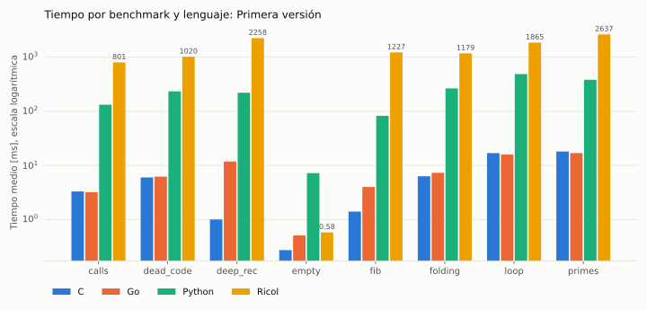

# Resultados de los benchmarks - Primera versión

Registro de una corrida de `make bench`, ejecutados con la versión de Ricol de
la primera entrega (commit `fb47426361601d1caaee4802b7bf08afce1ec63d`).

## Lenguajes

| Lenguaje | Implementación | Versión y compilación |
| :--- | :--- | :--- |
| C | GCC (compilador a código nativo) | gcc (Debian 14.2.0-19) 14.2.0, target `x86_64-linux-gnu`, flags `-O2`, glibc 2.41 |
| Go | gc (compilador oficial a código nativo) | go1.27.4 linux/amd64, `GOAMD64=v1`, `go build` sin flags |
| Python | Intérprete de bytecode | CPython 3.13.5, compilado con GCC 14.2.0; JIT: no; GIL: sí |
| Ricol | Intérprete tree-walking escrito en Go | compilado con el mismo Go que la fila anterior |

## Entorno

- CPU: Intel(R) Core(TM) Ultra 7 155H, núcleos asignados: 1
- Kernel: Linux 7.0.0-43-generic, contenedor Docker, Debian GNU/Linux 13 (trixie)
- hyperfine 1.19.0, con 2 corridas de calentamiento y 10 corridas medidas por programa, sin shell intermedio (`--shell=none`)

## Resumen

## calls

| Command | Mean [ms] | Min [ms] | Max [ms] | Relative |
| :--- | ---: | ---: | ---: | ---: |
| `C` | 3.3 ± 0.0 | 3.3 | 3.4 | 1.03 ± 0.03 |
| `Go` | 3.2 ± 0.1 | 3.1 | 3.5 | 1.00 |
| `Python` | 132.5 ± 7.9 | 125.5 | 151.0 | 41.41 ± 2.79 |
| `Ricol` | 801.2 ± 7.6 | 794.8 | 816.2 | 250.38 ± 8.18 |

## dead_code

| Command | Mean [ms] | Min [ms] | Max [ms] | Relative |
| :--- | ---: | ---: | ---: | ---: |
| `C` | 6.0 ± 0.1 | 5.9 | 6.2 | 1.00 |
| `Go` | 6.2 ± 0.1 | 6.0 | 6.4 | 1.03 ± 0.02 |
| `Python` | 233.9 ± 6.7 | 227.6 | 246.2 | 38.98 ± 1.29 |
| `Ricol` | 1020.0 ± 4.0 | 1015.0 | 1026.0 | 170.00 ± 2.91 |

## deep_rec

| Command | Mean [ms] | Min [ms] | Max [ms] | Relative |
| :--- | ---: | ---: | ---: | ---: |
| `C` | 1.0 ± 0.0 | 0.9 | 1.1 | 1.00 |
| `Go` | 11.8 ± 0.3 | 11.5 | 12.4 | 11.92 ± 0.58 |
| `Python` | 220.5 ± 2.2 | 216.9 | 224.4 | 222.77 ± 9.47 |
| `Ricol` | 2258.0 ± 32.0 | 2212.0 | 2309.0 | 2281.27 ± 99.66 |

## empty

| Command | Mean [µs] | Min [µs] | Max [µs] | Relative |
| :--- | ---: | ---: | ---: | ---: |
| `C` | 271.9 ± 30.1 | 248.7 | 334.2 | 1.00 |
| `Go` | 506.6 ± 33.5 | 474.0 | 580.1 | 1.86 ± 0.24 |
| `Python` | 7200.0 ± 100.0 | 7100.0 | 7400.0 | 26.48 ± 2.95 |
| `Ricol` | 576.1 ± 46.2 | 534.2 | 688.4 | 2.12 ± 0.29 |

## fib

| Command | Mean [ms] | Min [ms] | Max [ms] | Relative |
| :--- | ---: | ---: | ---: | ---: |
| `C` | 1.4 ± 0.0 | 1.3 | 1.4 | 1.00 |
| `Go` | 4.0 ± 0.1 | 3.9 | 4.3 | 2.86 ± 0.07 |
| `Python` | 82.7 ± 1.0 | 81.6 | 84.9 | 59.07 ± 0.71 |
| `Ricol` | 1227.0 ± 8.0 | 1215.0 | 1240.0 | 876.43 ± 5.71 |

## folding

| Command | Mean [ms] | Min [ms] | Max [ms] | Relative |
| :--- | ---: | ---: | ---: | ---: |
| `C` | 6.3 ± 0.1 | 6.1 | 6.4 | 1.00 |
| `Go` | 7.3 ± 0.2 | 7.1 | 7.5 | 1.16 ± 0.04 |
| `Python` | 265.4 ± 2.9 | 261.1 | 270.0 | 42.13 ± 0.81 |
| `Ricol` | 1179.0 ± 6.0 | 1172.0 | 1191.0 | 187.14 ± 3.12 |

## loop

| Command | Mean [ms] | Min [ms] | Max [ms] | Relative |
| :--- | ---: | ---: | ---: | ---: |
| `C` | 16.9 ± 0.5 | 16.2 | 17.6 | 1.06 ± 0.04 |
| `Go` | 15.9 ± 0.3 | 15.6 | 16.5 | 1.00 |
| `Python` | 488.3 ± 8.0 | 478.4 | 500.9 | 30.71 ± 0.77 |
| `Ricol` | 1865.0 ± 13.0 | 1849.0 | 1890.0 | 117.30 ± 2.36 |

## primes

| Command | Mean [ms] | Min [ms] | Max [ms] | Relative |
| :--- | ---: | ---: | ---: | ---: |
| `C` | 18.1 ± 0.5 | 17.3 | 18.9 | 1.07 ± 0.03 |
| `Go` | 16.9 ± 0.2 | 16.7 | 17.3 | 1.00 |
| `Python` | 382.8 ± 4.9 | 375.5 | 391.1 | 22.65 ± 0.39 |
| `Ricol` | 2637.0 ± 18.0 | 2618.0 | 2680.0 | 156.04 ± 2.13 |

## Conclusiones

### Ricol frente a Python

Ricol es entre 3.8 y 14.8 veces más lento que CPython. La distancia depende de
cuántas llamadas a funciones hace el programa:

| Benchmark | Ricol / Python | Qué predomina |
| :--- | ---: | :--- |
| `loop` | 3.8× | Aritmética y asignaciones dentro de un `while` |
| `dead_code` | 4.4× | Condiciones y ramas dentro de un `while` |
| `folding` | 4.4× | Aritmética con subexpresiones constantes dentro de un `while` |
| `calls` | 6.0× | Una llamada corta por iteración |
| `primes` | 6.9× | Loops anidados, con una llamada por número |
| `deep_rec` | 10.2× | Llamadas con pila muy profunda |
| `fib` | 14.8× | Solo llamadas |

Tomando solo el tiempo de ejecución, sin el arranque, una iteración de `loop`
cuesta unos 370 ns en Ricol contra 96 ns en Python. Una llamada de `fib`
cuesta 455 ns contra 28 ns: las llamadas a funciones son el principal punto
débil de Ricol.

El arranque de Ricol, en cambio, es barato. `empty` tarda 0.58 ms, casi lo
mismo que un binario de Go vacío (0.51 ms) y unas 12 veces menos que CPython
(7.2 ms). El scanner, el parser y el typechecker no son un problema.

### Dónde se va el tiempo en Ricol

Los perfiles muestran que el costo no está en la aritmética, sino en las
estructuras que el intérprete crea y recorre. Entre ellas se encuentran los
environments nuevos que se crean en cada llamada a función, los números que se
utilizan mediante una interfaz, el `return` implementado como `error` y el
`scopeStack`.

### Limitaciones

- Todas las mediciones son de una sola máquina, usando un solo núcleo dentro
  de Docker. Los tiempos absolutos cambian entre máquinas; las proporciones
  entre lenguajes son más estables.
- CPython 3.13 corre sin JIT. Con PyPy u otro intérprete con JIT, la
  comparación contra Python cambiaría mucho.
- `deep_rec` usa profundidades menores a 10000 porque ese es el límite de
  llamadas anidadas de Ricol (`maxCallDepth`). No mide recursiones más
  profundas en ningún lenguaje.
