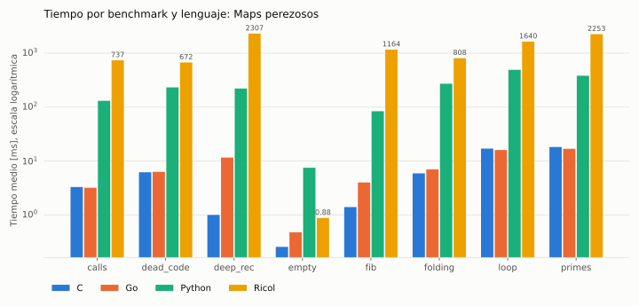
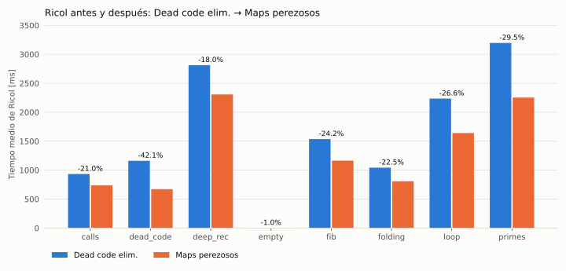

# Resultados de los benchmarks - Maps perezosos en los environments

Registro de una corrida de `make bench` después de hacer que los environments
del intérprete creen sus maps recién cuando se usan (commit
`731407f404ce40871658fae2c7b9a72ad573acd8`). Es la tercera optimización
implementada y la primera del intérprete. Se compara contra la versión con
[dead code elimination](results_dead_code_elimination.md).

## La optimización

En el intérprete de Ricol, un **environment** guarda los nombres definidos en un
scope: variables, funciones, structs y enums, cada uno en su propio map. El
intérprete crea un environment nuevo cada vez que entra a un bloque (el cuerpo
de un `while`, la rama de un `if`) y cada vez que llama a una función.

Hasta ahora, `newEnvironment` creaba los cuatro maps de entrada, aunque el
bloque no fuera a definir nada. En Go, un map vacío creado con `map[K]V{}`
igual reserva memoria para su estructura interna, así que entrar a un bloque
costaba cinco reservas de memoria (el environment y sus cuatro maps), que
después el recolector de basura tenía que liberar. En un loop, eso pasa en cada
iteración.

La optimización consiste en inicializar el environment de forma _lazy_
(_lazy initialization_). El environment empieza con los cuatro maps en `nil`, y
cada uno se crea la primera vez que se define algo de ese tipo:

```go
func newEnvironment(enclosing *environment) *environment {
 return &environment{enclosing: enclosing}
}

func (e *environment) define(name string, value types.Value) {
 if e.values == nil {
  e.values = map[string]types.Value{}
 }
 e.values[name] = value
}
```

Las búsquedas no cambian: en Go, leer de un map `nil` es válido y devuelve "no
encontrado", igual que un map vacío.

Este costo es el que hizo a la [versión base](results_baseline.md) entre 14% y
27% más lenta que la primera versión: para soportar structs y enums, cada
environment pasó de 2 a 4 maps.

**Benchmarks que deberían mejorar**: todos los que entran a bloques o llaman
funciones en un loop, o sea todos salvo `empty`. Más los que entran a muchos
bloques por iteración con poco trabajo adentro, como `dead_code`.

## Lenguajes

| Lenguaje | Implementación | Versión y compilación |
| :--- | :--- | :--- |
| C | GCC (compilador a código nativo) | gcc (Debian 14.2.0-19) 14.2.0, target `x86_64-linux-gnu`, flags `-O2`, glibc 2.41 |
| Go | gc (compilador oficial a código nativo) | go1.27.4 linux/amd64, `GOAMD64=v1`, `go build` sin flags |
| Python | Intérprete de bytecode | CPython 3.13.5, compilado con GCC 14.2.0; JIT: no; GIL: sí |
| Ricol | Intérprete tree-walking escrito en Go | compilado con el mismo Go que la fila anterior |

## Entorno

- CPU: Intel(R) Core(TM) Ultra 7 155H, núcleos asignados: 1
- Kernel: Linux 7.0.0-43-generic, contenedor Docker, Debian GNU/Linux 13 (trixie)
- hyperfine 1.19.0, con 2 corridas de calentamiento y 10 corridas medidas por programa, sin shell intermedio (`--shell=none`)

## Resumen



## calls

| Command | Mean [ms] | Min [ms] | Max [ms] | Relative |
| :--- | ---: | ---: | ---: | ---: |
| `C` | 3.3 ± 0.0 | 3.3 | 3.3 | 1.03 ± 0.03 |
| `Go` | 3.2 ± 0.1 | 3.1 | 3.3 | 1.00 |
| `Python` | 130.8 ± 5.7 | 124.7 | 139.5 | 40.88 ± 2.19 |
| `Ricol` | 736.8 ± 7.8 | 726.5 | 751.8 | 230.25 ± 7.60 |

## dead_code

| Command | Mean [ms] | Min [ms] | Max [ms] | Relative |
| :--- | ---: | ---: | ---: | ---: |
| `C` | 6.2 ± 0.1 | 6.1 | 6.6 | 1.00 |
| `Go` | 6.3 ± 0.1 | 6.2 | 6.4 | 1.02 ± 0.02 |
| `Python` | 232.0 ± 4.8 | 225.9 | 237.3 | 37.42 ± 0.98 |
| `Ricol` | 672.1 ± 3.5 | 668.0 | 677.7 | 108.40 ± 1.84 |

## deep_rec

| Command | Mean [ms] | Min [ms] | Max [ms] | Relative |
| :--- | ---: | ---: | ---: | ---: |
| `C` | 1.0 ± 0.0 | 0.9 | 1.0 | 1.00 |
| `Go` | 11.6 ± 0.4 | 11.2 | 12.5 | 12.04 ± 0.57 |
| `Python` | 221.1 ± 1.9 | 218.8 | 224.1 | 229.48 ± 7.83 |
| `Ricol` | 2307.0 ± 40.0 | 2238.0 | 2379.0 | 2394.40 ± 89.27 |

## empty

| Command | Mean [µs] | Min [µs] | Max [µs] | Relative |
| :--- | ---: | ---: | ---: | ---: |
| `C` | 256.3 ± 8.4 | 248.4 | 277.9 | 1.00 |
| `Go` | 478.2 ± 20.0 | 457.9 | 520.7 | 1.87 ± 0.10 |
| `Python` | 7500.0 ± 200.0 | 7200.0 | 7800.0 | 29.26 ± 1.24 |
| `Ricol` | 880.4 ± 11.6 | 860.4 | 900.9 | 3.44 ± 0.12 |

## fib

| Command | Mean [ms] | Min [ms] | Max [ms] | Relative |
| :--- | ---: | ---: | ---: | ---: |
| `C` | 1.4 ± 0.0 | 1.3 | 1.4 | 1.00 |
| `Go` | 4.0 ± 0.0 | 4.0 | 4.1 | 2.86 ± 0.00 |
| `Python` | 83.8 ± 1.1 | 82.0 | 85.3 | 59.86 ± 0.79 |
| `Ricol` | 1164.0 ± 7.0 | 1157.0 | 1182.0 | 831.43 ± 5.00 |

## folding

| Command | Mean [ms] | Min [ms] | Max [ms] | Relative |
| :--- | ---: | ---: | ---: | ---: |
| `C` | 5.9 ± 0.1 | 5.9 | 6.0 | 1.00 |
| `Go` | 7.0 ± 0.1 | 6.9 | 7.1 | 1.19 ± 0.03 |
| `Python` | 271.3 ± 11.0 | 263.2 | 301.4 | 45.98 ± 2.02 |
| `Ricol` | 808.4 ± 3.8 | 802.4 | 814.6 | 137.02 ± 2.41 |

## loop

| Command | Mean [ms] | Min [ms] | Max [ms] | Relative |
| :--- | ---: | ---: | ---: | ---: |
| `C` | 17.0 ± 0.5 | 16.3 | 17.8 | 1.06 ± 0.04 |
| `Go` | 16.0 ± 0.3 | 15.6 | 16.4 | 1.00 |
| `Python` | 491.0 ± 9.2 | 483.1 | 510.6 | 30.69 ± 0.81 |
| `Ricol` | 1640.0 ± 8.0 | 1632.0 | 1653.0 | 102.50 ± 1.99 |

## primes

| Command | Mean [ms] | Min [ms] | Max [ms] | Relative |
| :--- | ---: | ---: | ---: | ---: |
| `C` | 18.2 ± 0.5 | 17.4 | 18.9 | 1.08 ± 0.04 |
| `Go` | 16.9 ± 0.3 | 16.7 | 17.5 | 1.00 |
| `Python` | 382.0 ± 3.6 | 375.8 | 386.7 | 22.60 ± 0.45 |
| `Ricol` | 2253.0 ± 16.0 | 2235.0 | 2282.0 | 133.31 ± 2.55 |

## Comparación con dead code elimination



| Benchmark | Dead code elimination | Maps perezosos | Cambio |
| :--- | ---: | ---: | ---: |
| `calls` | 933.0 ms | 736.8 ms | -21.0% |
| `dead_code` | 1161.0 ms | 672.1 ms | **-42.1%** |
| `deep_rec` | 2813.0 ms | 2307.0 ms | -18.0% |
| `empty` | 0.89 ms | 0.88 ms | -1.0% |
| `fib` | 1536.0 ms | 1164.0 ms | -24.2% |
| `folding` | 1043.0 ms | 808.4 ms | -22.5% |
| `loop` | 2235.0 ms | 1640.0 ms | -26.6% |
| `primes` | 3197.0 ms | 2253.0 ms | -29.5% |

Mejoran todos los benchmarks salvo `empty`, entre 18% y 42%. Es por lejos la
mejora más grande hasta ahora.

### De dónde sale la mejora

Segundos de CPU de cada función en los perfiles, contando lo que llama:

| Función | `loop`, antes | `loop`, después | `fib`, antes | `fib`, después |
| :--- | ---: | ---: | ---: | ---: |
| `newEnvironment` | 0.68 s | 0.03 s | 0.69 s | 0.13 s |
| Creación de maps (`makemap_small`) | 0.63 s | — | 0.60 s | 0.05 s |
| Recolector de basura | 0.21 s | 0.10 s | 0.28 s | 0.16 s |

En `loop`, el cuerpo del `while` no declara nada, así que su environment ya no
crea ningún map: el costo de entrar al bloque prácticamente desaparece. En
`fib`, cada llamada sigue creando un map, el de `values`, porque define el
parámetro `n`; pero ya no crea los otros tres.

Los que más mejoran son los que crean más environments en proporción a su
trabajo:

- `dead_code` (-42%) entra a dos bloques por iteración (el cuerpo del `while` y
  el bloque que quedó del `if (True)`), y casi no hace nada más.
- `primes` (-30%) entra a un bloque por cada iteración del loop interno, y a
  otro más cada vez que el `if` se cumple.
- `deep_rec` (-18%) es el que menos mejora: cada llamada define su parámetro, y
  con una pila de 9000 llamadas el recolector de basura tiene más memoria viva
  para recorrer.

### Frente a la primera versión

Con este paso, Ricol recupera lo que había perdido desde la primera entrega y
la supera en casi todos los benchmarks:

| Benchmark | Primera versión | Maps perezosos | Cambio |
| :--- | ---: | ---: | ---: |
| `calls` | 801.2 ms | 736.8 ms | -8.0% |
| `dead_code` | 1020.0 ms | 672.1 ms | -34.1% |
| `deep_rec` | 2258.0 ms | 2307.0 ms | +2.2% |
| `empty` | 0.58 ms | 0.88 ms | +52.8% |
| `fib` | 1227.0 ms | 1164.0 ms | -5.1% |
| `folding` | 1179.0 ms | 808.4 ms | -31.4% |
| `loop` | 1865.0 ms | 1640.0 ms | -12.1% |
| `primes` | 2637.0 ms | 2253.0 ms | -14.6% |

`empty` sigue más lento por el tamaño del binario (ver la
[versión base](results_baseline.md#el-arranque)), que esta optimización no
toca. `deep_rec` queda prácticamente igual que en la primera versión.

## Conclusiones

### Ricol frente a Python

| Benchmark | Ricol / Python | Dead code elimination |
| :--- | ---: | ---: |
| `dead_code` | 2.9× | 5.0× |
| `folding` | 3.0× | 3.9× |
| `loop` | 3.3× | 4.6× |
| `calls` | 5.6× | 7.1× |
| `primes` | 5.9× | 8.4× |
| `deep_rec` | 10.4× | 12.8× |
| `fib` | 13.9× | 18.6× |

Sin contar el arranque, una iteración de `loop` cuesta ahora unos 330 ns (450 ns
en la versión base, 97 ns en Python), y una llamada de `fib` unos 430 ns
(570 ns en la versión base, 28 ns en Python).

### Dónde se va el tiempo ahora

Porcentaje de las muestras de CPU de cada función, contando lo que llama
(perfiles tomados con `--cpuprofile`, fuera de Docker):

| Punto caliente | `loop` | `fib` | Optimización que lo ataca |
| :--- | ---: | ---: | :--- |
| `distanceOf` (`map[Expression]int`) | 25% | 10% | Distancia en el nodo |
| Paso de `Number` a la interfaz `Value` (`convTnoptr`) | 13% | 6% | Ninguna |
| Recolector de basura | 5% | 9% | — |
| `errors.As` para detectar el `return` | — | 9% | Return sin `errors.As` |
| `newEnvironment` | 2% | 8% | Esta optimización |

Con los environments resueltos, el punto más caro de `loop` pasa a ser
`distanceOf`: buscar en un map, por cada uso de una variable, a qué distancia
está su scope. Eso es lo que ataca la próxima optimización.

### Limitaciones

- Todas las mediciones son de una sola máquina, usando un solo núcleo dentro
  de Docker. Los tiempos absolutos cambian entre máquinas; las proporciones
  entre lenguajes son más estables.
- Los perfiles se tomaron fuera de Docker, sin limitar los núcleos. Sirven
  para comparar el peso de cada función, no los tiempos absolutos.
