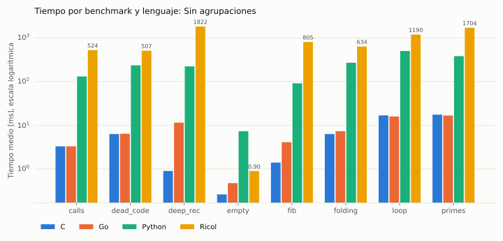
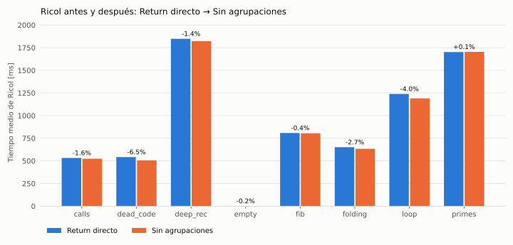

# Resultados de los benchmarks - Sin agrupaciones

Registro de una corrida de `make bench` después de que el optimizador saque del
AST los nodos de agrupación, los que el parser crea por cada par de paréntesis
(commit `3932ae90daf0c530e334abbd0e8229d84565ccfb`). Es la sexta optimización
implementada, y se compara contra la versión con
[return sin `errors.As`](results_return_signal.md).

## La optimización

Cuando el parser encuentra una expresión entre paréntesis, crea un nodo
`GroupingExpression` que la envuelve. Los paréntesis sirven para decidir la
**forma del árbol**: en `(acc + i) % 1000003`, gracias a ellos la suma queda
como hijo del módulo, y no al revés. Pero una vez armado el árbol, el nodo de
agrupación ya no aporta nada: el intérprete, al evaluarlo, solo evalúa la
expresión que tiene adentro.

```plaintext
Antes:  (% (GROUPING (+ acc i)) 1000003)
Después: (% (+ acc i) 1000003)
```

Igual, cada nodo de agrupación le cuesta al intérprete una pasada más por
`evaluate`: un _type switch_ para ver qué tipo de nodo es y una llamada
recursiva. El optimizador ahora reemplaza cada `GroupingExpression` por la
expresión que contiene. El paso 3 (constant folding) ya lo hacía cuando adentro
quedaba un literal; ahora lo hace siempre.

El cambio se hace en el optimizador y no en el parser, así `--parse` sigue
mostrando los paréntesis tal como se escribieron. Se verificó que no puede
cambiar el significado de un programa válido.

**Benchmarks que deberían mejorar**: los que tienen paréntesis en el camino
que se repite: `loop`, `calls`, `folding` y `dead_code`, con una agrupación por
iteración cada uno. `fib`, `deep_rec` y `primes` no tienen paréntesis, y su
AST optimizado queda idéntico al de la versión anterior.

## Lenguajes

| Lenguaje | Implementación | Versión y compilación |
| :--- | :--- | :--- |
| C | GCC (compilador a código nativo) | gcc (Debian 14.2.0-19) 14.2.0, target `x86_64-linux-gnu`, flags `-O2`, glibc 2.41 |
| Go | gc (compilador oficial a código nativo) | go1.27.4 linux/amd64, `GOAMD64=v1`, `go build` sin flags |
| Python | Intérprete de bytecode | CPython 3.13.5, compilado con GCC 14.2.0; JIT: no; GIL: sí |
| Ricol | Intérprete tree-walking escrito en Go | compilado con el mismo Go que la fila anterior |

## Entorno

- CPU: Intel(R) Core(TM) Ultra 7 155H, núcleos asignados: 1
- Kernel: Linux 7.0.0-43-generic, contenedor Docker, Debian GNU/Linux 13 (trixie)
- hyperfine 1.19.0, con 2 corridas de calentamiento y 10 corridas medidas por programa, sin shell intermedio (`--shell=none`)

## Resumen



## calls

| Command | Mean [ms] | Min [ms] | Max [ms] | Relative |
| :--- | ---: | ---: | ---: | ---: |
| `C` | 3.3 ± 0.1 | 3.3 | 3.5 | 1.00 |
| `Go` | 3.3 ± 0.0 | 3.2 | 3.3 | 1.00 ± 0.03 |
| `Python` | 130.7 ± 5.0 | 125.5 | 139.8 | 39.61 ± 1.93 |
| `Ricol` | 523.9 ± 5.7 | 517.3 | 535.2 | 158.76 ± 5.11 |

## dead_code

| Command | Mean [ms] | Min [ms] | Max [ms] | Relative |
| :--- | ---: | ---: | ---: | ---: |
| `C` | 6.3 ± 0.1 | 6.2 | 6.4 | 1.00 |
| `Go` | 6.4 ± 0.1 | 6.3 | 6.6 | 1.02 ± 0.02 |
| `Python` | 235.0 ± 5.0 | 227.3 | 244.4 | 37.30 ± 0.99 |
| `Ricol` | 506.7 ± 1.9 | 504.3 | 509.6 | 80.43 ± 1.31 |

## deep_rec

| Command | Mean [ms] | Min [ms] | Max [ms] | Relative |
| :--- | ---: | ---: | ---: | ---: |
| `C` | 0.9 ± 0.0 | 0.9 | 1.0 | 1.00 |
| `Go` | 11.5 ± 0.1 | 11.4 | 11.6 | 12.35 ± 0.38 |
| `Python` | 222.2 ± 3.3 | 218.6 | 228.0 | 238.69 ± 7.85 |
| `Ricol` | 1822.0 ± 32.0 | 1781.0 | 1867.0 | 1957.25 ± 66.91 |

## empty

| Command | Mean [µs] | Min [µs] | Max [µs] | Relative |
| :--- | ---: | ---: | ---: | ---: |
| `C` | 261.7 ± 20.0 | 240.8 | 295.3 | 1.00 |
| `Go` | 473.6 ± 15.9 | 455.4 | 505.7 | 1.81 ± 0.15 |
| `Python` | 7300.0 ± 100.0 | 7200.0 | 7500.0 | 27.89 ± 2.17 |
| `Ricol` | 895.4 ± 43.7 | 852.4 | 999.1 | 3.42 ± 0.31 |

## fib

| Command | Mean [ms] | Min [ms] | Max [ms] | Relative |
| :--- | ---: | ---: | ---: | ---: |
| `C` | 1.4 ± 0.1 | 1.4 | 1.6 | 1.00 |
| `Go` | 4.1 ± 0.1 | 4.0 | 4.2 | 2.93 ± 0.22 |
| `Python` | 91.1 ± 7.5 | 85.3 | 110.7 | 65.07 ± 7.09 |
| `Ricol` | 804.9 ± 6.4 | 794.1 | 813.9 | 574.93 ± 41.32 |

## folding

| Command | Mean [ms] | Min [ms] | Max [ms] | Relative |
| :--- | ---: | ---: | ---: | ---: |
| `C` | 6.3 ± 0.1 | 6.1 | 6.5 | 1.00 |
| `Go` | 7.3 ± 0.1 | 7.2 | 7.4 | 1.16 ± 0.02 |
| `Python` | 269.7 ± 4.0 | 265.3 | 277.7 | 42.81 ± 0.93 |
| `Ricol` | 633.7 ± 3.0 | 630.8 | 639.7 | 100.59 ± 1.67 |

## loop

| Command | Mean [ms] | Min [ms] | Max [ms] | Relative |
| :--- | ---: | ---: | ---: | ---: |
| `C` | 16.8 ± 0.4 | 16.2 | 17.5 | 1.06 ± 0.03 |
| `Go` | 15.9 ± 0.2 | 15.6 | 16.1 | 1.00 |
| `Python` | 500.3 ± 14.8 | 483.3 | 528.4 | 31.47 ± 1.01 |
| `Ricol` | 1190.0 ± 7.0 | 1181.0 | 1201.0 | 74.84 ± 1.04 |

## primes

| Command | Mean [ms] | Min [ms] | Max [ms] | Relative |
| :--- | ---: | ---: | ---: | ---: |
| `C` | 17.5 ± 0.4 | 16.9 | 18.1 | 1.05 ± 0.02 |
| `Go` | 16.7 ± 0.1 | 16.6 | 17.0 | 1.00 |
| `Python` | 380.9 ± 2.8 | 377.7 | 386.1 | 22.81 ± 0.22 |
| `Ricol` | 1704.0 ± 9.0 | 1694.0 | 1720.0 | 102.04 ± 0.81 |

## Comparación con return sin errors.As



| Benchmark | Return sin `errors.As` | Sin agrupaciones | Cambio |
| :--- | ---: | ---: | ---: |
| `calls` | 532.2 ms | 523.9 ms | -1.6% |
| `dead_code` | 542.1 ms | 506.7 ms | -6.5% |
| `deep_rec` | 1848.0 ms | 1822.0 ms | -1.4% |
| `empty` | 0.90 ms | 0.90 ms | -0.2% |
| `fib` | 808.1 ms | 804.9 ms | -0.4% |
| `folding` | 651.1 ms | 633.7 ms | -2.7% |
| `loop` | 1239.0 ms | 1190.0 ms | **-4.0%** |
| `primes` | 1702.0 ms | 1704.0 ms | +0.1% |

Como se esperaba, es la mejora más chica de las seis, y solo aparece en los
cuatro benchmarks con paréntesis en el loop. En `deep_rec`, `fib` y `primes`
el AST optimizado es idéntico al anterior, así que sus diferencias son ruido.

### Cuánto pesa un nodo

Cada uno de los cuatro benchmarks que mejoran se ahorra un nodo por
iteración:

| Benchmark | Nodos por iteración, antes | Después | Menos nodos | Cambio de tiempo |
| :--- | ---: | ---: | ---: | ---: |
| `loop` | 16 | 15 | -6% | -4.0% |
| `dead_code` | 14 | 13 | -7% | -4.5% |
| `folding` | 20 | 19 | -5% | -2.7% |
| `calls` | 19 | 18 | -5% | -1.6% |

El tiempo baja menos que la cantidad de nodos porque cada iteración tiene
costos que no son nodos de expresión: el dispatch de las sentencias, crear el
environment del cuerpo del `while` y, en `calls`, hacer la llamada. Por eso
`calls`, que es el que más trabajo extra tiene por iteración, es el que menos
mejora.

## Conclusiones

### Ricol frente a Python

| Benchmark | Ricol / Python | Return sin `errors.As` |
| :--- | ---: | ---: |
| `dead_code` | 2.2× | 2.3× |
| `folding` | 2.3× | 2.4× |
| `loop` | 2.4× | 2.5× |
| `calls` | 4.0× | 4.0× |
| `primes` | 4.5× | 4.4× |
| `deep_rec` | 8.2× | 7.6× |
| `fib` | 8.8× | 9.4× |

Los cambios en `deep_rec` y `fib` vienen de Python, no de Ricol: en esta
corrida, Python tuvo valores atípicos en `fib` (91.1 ± 7.5 ms, con una corrida
de 110.7 ms) y tardó menos en `deep_rec` que en la anterior.

### Dónde se va el tiempo ahora

El perfil de `loop` es prácticamente el mismo que con
[return sin `errors.As`](results_return_signal.md#dónde-se-va-el-tiempo-ahora):
la búsqueda en los maps de strings de los environments (23%) y el paso de
`Number` a la interfaz `Value` (19%) son los puntos más caros. Ninguna de las
optimizaciones los ataca.

### Las seis optimizaciones juntas

Con este paso se terminan las optimizaciones aplicadas. Contra la
[versión base](results_baseline.md), sin optimizaciones:

| Benchmark | Versión base | Sin agrupaciones | Cambio |
| :--- | ---: | ---: | ---: |
| `calls` | 924.9 ms | 523.9 ms | -43.4% |
| `dead_code` | 1297.0 ms | 506.7 ms | -60.9% |
| `deep_rec` | 2805.0 ms | 1822.0 ms | -35.0% |
| `empty` | 0.95 ms | 0.90 ms | -6.0% |
| `fib` | 1531.0 ms | 804.9 ms | -47.4% |
| `folding` | 1347.0 ms | 633.7 ms | -53.0% |
| `loop` | 2235.0 ms | 1190.0 ms | -46.8% |
| `primes` | 3252.0 ms | 1704.0 ms | -47.6% |

En el resumen final se muestra el análisis completo.

### Limitaciones

- Todas las mediciones son de una sola máquina, usando un solo núcleo dentro
  de Docker. Los tiempos absolutos cambian entre máquinas; las proporciones
  entre lenguajes son más estables.
- El perfil se tomó fuera de Docker, sin limitar los núcleos. Sirve para
  comparar el peso de cada función, no los tiempos absolutos.
