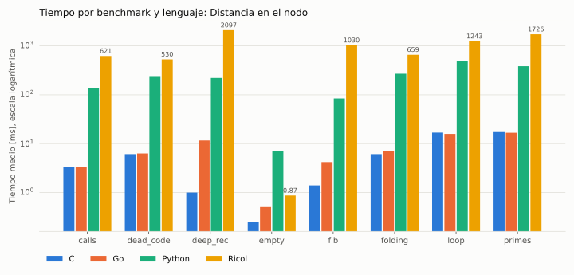
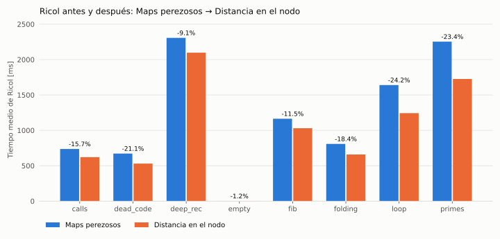

# Resultados de los benchmarks - Distancia en el nodo

Registro de una corrida de `make bench` después de guardar la distancia de
cada variable en el propio nodo del AST, en vez de en un map aparte
(commit `101d5b572be283e7d7aa3cadc6045b8ff8a89b60`). Es la cuarta optimización
implementada, y se compara contra la versión con
[maps perezosos](results_lazy_environments.md).

## La optimización

Cuando el typechecker encuentra un uso de una variable, calcula su
**distancia**: cuántos scopes hacia afuera hay que subir, desde donde se usa,
para llegar a donde se declaró. Por ejemplo, en

```ricol
let total: Int = 0;
while (total < 10) {
    total = total + 1;
}
```

los usos de `total` dentro del `while` tienen distancia 1, porque el cuerpo del
`while` es un scope nuevo y `total` está declarada en el de afuera. Con la
distancia, el intérprete va directo al environment correcto en vez de buscar
el nombre scope por scope. Lo mismo vale para las llamadas a funciones y los
literales de structs.

Hasta ahora, el typechecker devolvía las distancias en un
`map[common.Expression]int`, una **tabla aparte** indexada por nodo. El
intérprete buscaba en ese map cada vez que evaluaba una variable. La clave del
map es una interfaz, así que cada búsqueda tenía que calcular el hash del tipo
dinámico y del puntero, y después comparar las claves como interfaces.

Con la optimización, el typechecker escribe la distancia en un campo
`Distance` del propio nodo, y el intérprete la lee directamente:

```go
// Antes
distance, ok := i.distances[expression]

// Después
distance := expression.Distance
```

Es la diferencia entre un **AST decorado**, donde el análisis guarda sus
resultados en los nodos (como javac o clang), y las **tablas aparte**, donde
los guarda en estructuras indexadas por nodo (como `go/types` o el resolver de
*Crafting Interpreters*). Las dos son válidas, pero para el intérprete leer un
campo es mucho más barato que buscar en un map.

**Benchmarks que deberían mejorar**: todos los que usan variables en un loop,
o sea todos salvo `empty`. Más los que hacen muchos accesos a variables por
iteración, como `loop`.

## Lenguajes

| Lenguaje | Implementación | Versión y compilación |
| :--- | :--- | :--- |
| C | GCC (compilador a código nativo) | gcc (Debian 14.2.0-19) 14.2.0, target `x86_64-linux-gnu`, flags `-O2`, glibc 2.41 |
| Go | gc (compilador oficial a código nativo) | go1.27.4 linux/amd64, `GOAMD64=v1`, `go build` sin flags |
| Python | Intérprete de bytecode | CPython 3.13.5, compilado con GCC 14.2.0; JIT: no; GIL: sí |
| Ricol | Intérprete tree-walking escrito en Go | compilado con el mismo Go que la fila anterior |

## Entorno

- CPU: Intel(R) Core(TM) Ultra 7 155H, núcleos asignados: 1
- Kernel: Linux 7.0.0-43-generic, contenedor Docker, Debian GNU/Linux 13 (trixie)
- hyperfine 1.19.0, con 2 corridas de calentamiento y 10 corridas medidas por programa, sin shell intermedio (`--shell=none`)

## Resumen



## calls

| Command | Mean [ms] | Min [ms] | Max [ms] | Relative |
| :--- | ---: | ---: | ---: | ---: |
| `C` | 3.3 ± 0.0 | 3.3 | 3.5 | 1.00 |
| `Go` | 3.3 ± 0.1 | 3.2 | 3.4 | 1.00 ± 0.03 |
| `Python` | 136.6 ± 10.4 | 126.2 | 158.5 | 41.39 ± 3.15 |
| `Ricol` | 621.1 ± 15.9 | 613.1 | 665.5 | 188.21 ± 4.82 |

## dead_code

| Command | Mean [ms] | Min [ms] | Max [ms] | Relative |
| :--- | ---: | ---: | ---: | ---: |
| `C` | 6.1 ± 0.1 | 6.0 | 6.3 | 1.00 |
| `Go` | 6.3 ± 0.1 | 6.2 | 6.3 | 1.03 ± 0.02 |
| `Python` | 241.3 ± 10.5 | 228.9 | 258.7 | 39.56 ± 1.84 |
| `Ricol` | 530.3 ± 8.9 | 523.1 | 553.1 | 86.93 ± 2.04 |

## deep_rec

| Command | Mean [ms] | Min [ms] | Max [ms] | Relative |
| :--- | ---: | ---: | ---: | ---: |
| `C` | 1.0 ± 0.0 | 0.9 | 1.1 | 1.00 |
| `Go` | 11.6 ± 0.2 | 11.4 | 12.0 | 12.07 ± 0.50 |
| `Python` | 221.3 ± 1.5 | 219.1 | 222.8 | 230.23 ± 8.90 |
| `Ricol` | 2097.0 ± 32.0 | 2066.0 | 2148.0 | 2181.65 ± 89.49 |

## empty

| Command | Mean [µs] | Min [µs] | Max [µs] | Relative |
| :--- | ---: | ---: | ---: | ---: |
| `C` | 251.4 ± 8.9 | 240.0 | 268.4 | 1.00 |
| `Go` | 503.3 ± 42.5 | 461.1 | 592.0 | 2.00 ± 0.18 |
| `Python` | 7200.0 ± 100.0 | 7100.0 | 7400.0 | 28.64 ± 1.09 |
| `Ricol` | 869.8 ± 12.7 | 850.4 | 885.9 | 3.46 ± 0.13 |

## fib

| Command | Mean [ms] | Min [ms] | Max [ms] | Relative |
| :--- | ---: | ---: | ---: | ---: |
| `C` | 1.4 ± 0.0 | 1.4 | 1.5 | 1.00 |
| `Go` | 4.2 ± 0.0 | 4.1 | 4.2 | 3.00 ± 0.00 |
| `Python` | 84.1 ± 1.2 | 82.4 | 86.2 | 60.07 ± 0.86 |
| `Ricol` | 1030.0 ± 7.0 | 1017.0 | 1042.0 | 735.71 ± 5.00 |

## folding

| Command | Mean [ms] | Min [ms] | Max [ms] | Relative |
| :--- | ---: | ---: | ---: | ---: |
| `C` | 6.1 ± 0.1 | 6.0 | 6.3 | 1.00 |
| `Go` | 7.2 ± 0.0 | 7.1 | 7.3 | 1.18 ± 0.02 |
| `Python` | 270.4 ± 3.6 | 264.9 | 276.4 | 44.33 ± 0.94 |
| `Ricol` | 659.3 ± 6.5 | 648.8 | 667.9 | 108.08 ± 2.07 |

## loop

| Command | Mean [ms] | Min [ms] | Max [ms] | Relative |
| :--- | ---: | ---: | ---: | ---: |
| `C` | 16.8 ± 0.5 | 16.2 | 17.6 | 1.06 ± 0.03 |
| `Go` | 15.8 ± 0.2 | 15.6 | 16.4 | 1.00 |
| `Python` | 494.3 ± 13.9 | 478.6 | 517.7 | 31.28 ± 0.96 |
| `Ricol` | 1243.0 ± 7.0 | 1233.0 | 1253.0 | 78.67 ± 1.09 |

## primes

| Command | Mean [ms] | Min [ms] | Max [ms] | Relative |
| :--- | ---: | ---: | ---: | ---: |
| `C` | 17.9 ± 0.3 | 17.4 | 18.5 | 1.07 ± 0.02 |
| `Go` | 16.7 ± 0.2 | 16.6 | 17.3 | 1.00 |
| `Python` | 384.2 ± 9.1 | 376.2 | 408.0 | 23.01 ± 0.61 |
| `Ricol` | 1726.0 ± 9.0 | 1715.0 | 1746.0 | 103.35 ± 1.35 |

## Comparación con maps perezosos



| Benchmark | Maps perezosos | Distancia en el nodo | Cambio |
| :--- | ---: | ---: | ---: |
| `calls` | 736.8 ms | 621.1 ms | -15.7% |
| `dead_code` | 672.1 ms | 530.3 ms | -21.1% |
| `deep_rec` | 2307.0 ms | 2097.0 ms | -9.1% |
| `empty` | 0.88 ms | 0.87 ms | -1.2% |
| `fib` | 1164.0 ms | 1030.0 ms | -11.5% |
| `folding` | 808.4 ms | 659.3 ms | -18.4% |
| `loop` | 1640.0 ms | 1243.0 ms | **-24.2%** |
| `primes` | 2253.0 ms | 1726.0 ms | -23.4% |

Mejoran todos los benchmarks salvo `empty`, entre 9% y 24%.

### De dónde sale la mejora

En el perfil de `loop` con maps perezosos, `distanceOf` se llevaba 0.47 s, un
25% de las muestras, casi todo en la búsqueda del map con clave de tipo
interfaz. Con este cambio, `distanceOf` ya no aparece en el perfil: es una
lectura de un campo y una comparación.

Cuánto mejora cada benchmark depende de cuántas variables usa por iteración en
proporción al resto del trabajo:

- `loop` (-24%) y `primes` (-23%) evalúan sobre todo expresiones con
  variables. Cada iteración de `loop` lee `acc` e `i` y asigna las dos. El loop
  interno de `primes` lee `d` y `n` seis veces entre `d * d <= n`,
  `n % d == 0` y `d = d + 1`.
- `fib` (-12%) y `deep_rec` (-9%) usan pocas variables por llamada. En ellos
  pesa más el costo de la llamada en sí: crear el environment, definir el
  parámetro y detectar el `return`.

## Conclusiones

### Ricol frente a Python

| Benchmark | Ricol / Python | Maps perezosos |
| :--- | ---: | ---: |
| `dead_code` | 2.2× | 2.9× |
| `folding` | 2.4× | 3.0× |
| `loop` | 2.5× | 3.3× |
| `primes` | 4.5× | 5.9× |
| `calls` | 4.5× | 5.6× |
| `deep_rec` | 9.5× | 10.4× |
| `fib` | 12.2× | 13.9× |

Sin contar el arranque, una iteración de `loop` cuesta ahora unos 250 ns
(450 ns en la versión base, 97 ns en Python), y una llamada de `fib` unos
380 ns (570 ns en la versión base, 29 ns en Python).

Contra la [versión base](results_baseline.md), todos los benchmarks salvo
`empty` están ahora entre 25% y 59% más rápidos.

### Dónde se va el tiempo ahora

Porcentaje de las muestras de CPU de cada función, contando lo que llama
(perfiles tomados con `--cpuprofile`, fuera de Docker):

| Punto caliente | `loop` | `fib` | Optimización que lo ataca |
| :--- | ---: | ---: | :--- |
| Búsqueda en los maps de strings de los environments | 22% | 6% | Ninguna |
| Paso de `Number` a la interfaz `Value` | 18% | 4% | Ninguna |
| `errors.As` para detectar el `return` | — | 15% | Return sin `errors.As` |
| Recolector de basura | 5% | 10% | — |
| `newEnvironment` | 5% | 4% | Maps perezosos (ya aplicada) |

La distancia dice en qué environment está la variable, pero adentro de ese
environment se la sigue buscando por nombre, en un map de strings. Resolver
cada variable a una posición fija de un arreglo evitaría esa búsqueda, y podría
ser una optimización adicional.

En `fib`, `errors.As` pasa a ser el punto más caro, y es la próxima
optimización.

### Limitaciones

- Todas las mediciones son de una sola máquina, usando un solo núcleo dentro
  de Docker. Los tiempos absolutos cambian entre máquinas; las proporciones
  entre lenguajes son más estables.
- Los perfiles se tomaron fuera de Docker, sin limitar los núcleos. Sirven
  para comparar el peso de cada función, no los tiempos absolutos.
