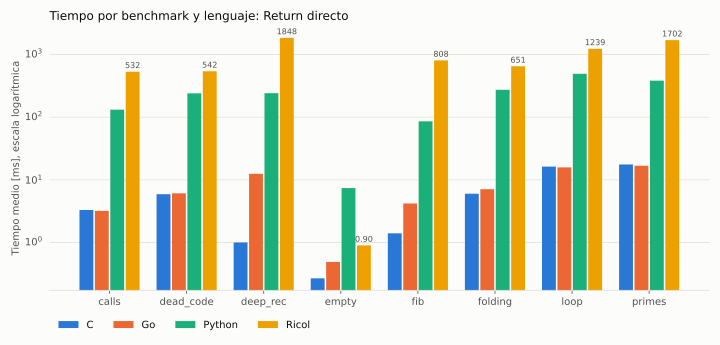
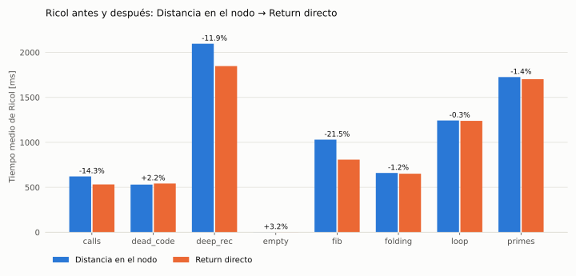

# Resultados de los benchmarks - Return sin errors.As

Registro de una corrida de `make bench` después de cambiar cómo el intérprete
detecta un `return` (commit `2cfffefbbd5fb643bc3078ba9d7be95e9b6ce4ed`). Es la
quinta optimización implementada, y se compara contra la versión con la
[distancia en el nodo](results_node_distances.md).

## La optimización

En el intérprete de Ricol, un `return` se implementa como un error especial,
`returnSignal`, que lleva el valor devuelto. Ejecutar `return x;` devuelve ese
error, que sube por todas las sentencias que lo contienen (bloques, `if`,
`while`, `match`) hasta llegar a la llamada a la función. Ahí, después de cada
sentencia del cuerpo, el intérprete se fija si el error es un `returnSignal`.
Es la técnica habitual para salir de varios niveles de un intérprete que
recorre el árbol. *Crafting Interpreters* hace lo mismo con una excepción.

Hasta ahora, esa comprobación usaba `errors.As`, la función de Go para
preguntar si un error es de cierto tipo, incluso si está envuelto dentro de
otro error:

```go
// Antes
var signal *returnSignal
if errors.As(err, &signal) {
  return signal.value, nil
}

// Después
if signal, ok := err.(*returnSignal); ok {
  return signal.value, nil
}
```

`errors.As` es general, y eso tiene dos costos:

- **Usa reflexión.** Para ver si el error es del tipo pedido, recorre los
  tipos en tiempo de ejecución (`reflectlite.ValueOf`, `Implements`,
  `AssignableTo`) y copia el resultado con `Set`. Esto pasa en cada `return`,
  o sea, una vez por llamada.
- **Hace que `signal` se reserve en el heap.** Como `&signal` se pasa como
  `any`, el compilador de Go no puede probar que no sobrevive a la llamada, y la
  mueve al heap. La variable se declara adentro del loop sobre las sentencias
  del cuerpo, así que **cada sentencia ejecutada dentro de una función**
  reservaba memoria, haya o no un `return`. Se puede ver con el análisis de
  escape del compilador (`go build -gcflags=-m`), que en la versión anterior
  marcaba `moved to heap: signal` y ahora ya no.

La type assertion (`err.(*returnSignal)`) solo compara el tipo dinámico del
error con uno conocido. Es suficiente porque el `returnSignal` nunca se envuelve
en otro error: viaja tal cual desde el `return` hasta la llamada.

**Benchmarks que deberían mejorar**: los que hacen muchas llamadas a funciones
(`fib`, `calls`, `deep_rec`) y, en menor medida, `primes`, que hace una llamada
por número. Los que no llaman funciones (`loop`, `folding`, `dead_code`) no
deberían cambiar.

## Lenguajes

| Lenguaje | Implementación | Versión y compilación |
| :--- | :--- | :--- |
| C | GCC (compilador a código nativo) | gcc (Debian 14.2.0-19) 14.2.0, target `x86_64-linux-gnu`, flags `-O2`, glibc 2.41 |
| Go | gc (compilador oficial a código nativo) | go1.27.4 linux/amd64, `GOAMD64=v1`, `go build` sin flags |
| Python | Intérprete de bytecode | CPython 3.13.5, compilado con GCC 14.2.0; JIT: no; GIL: sí |
| Ricol | Intérprete tree-walking escrito en Go | compilado con el mismo Go que la fila anterior |

## Entorno

- CPU: Intel(R) Core(TM) Ultra 7 155H, núcleos asignados: 1
- Kernel: Linux 7.0.0-43-generic, contenedor Docker, Debian GNU/Linux 13 (trixie)
- hyperfine 1.19.0, con 2 corridas de calentamiento y 10 corridas medidas por programa, sin shell intermedio (`--shell=none`)

## Resumen



## calls

| Command | Mean [ms] | Min [ms] | Max [ms] | Relative |
| :--- | ---: | ---: | ---: | ---: |
| `C` | 3.3 ± 0.0 | 3.3 | 3.4 | 1.03 ± 0.00 |
| `Go` | 3.2 ± 0.0 | 3.2 | 3.3 | 1.00 |
| `Python` | 131.9 ± 7.2 | 125.8 | 150.5 | 41.22 ± 2.25 |
| `Ricol` | 532.2 ± 7.1 | 524.4 | 544.5 | 166.31 ± 2.22 |

## dead_code

| Command | Mean [ms] | Min [ms] | Max [ms] | Relative |
| :--- | ---: | ---: | ---: | ---: |
| `C` | 5.9 ± 0.1 | 5.9 | 6.0 | 1.00 |
| `Go` | 6.1 ± 0.1 | 6.0 | 6.3 | 1.03 ± 0.02 |
| `Python` | 240.7 ± 13.1 | 226.9 | 264.6 | 40.80 ± 2.33 |
| `Ricol` | 542.1 ± 13.7 | 524.2 | 574.0 | 91.88 ± 2.80 |

## deep_rec

| Command | Mean [ms] | Min [ms] | Max [ms] | Relative |
| :--- | ---: | ---: | ---: | ---: |
| `C` | 1.0 ± 0.0 | 1.0 | 1.0 | 1.00 |
| `Go` | 12.5 ± 0.1 | 12.4 | 12.7 | 12.77 ± 0.28 |
| `Python` | 242.2 ± 8.7 | 233.5 | 261.9 | 247.34 ± 10.27 |
| `Ricol` | 1848.0 ± 29.0 | 1812.0 | 1894.0 | 1887.25 ± 49.22 |

## empty

| Command | Mean [µs] | Min [µs] | Max [µs] | Relative |
| :--- | ---: | ---: | ---: | ---: |
| `C` | 268.0 ± 24.8 | 244.7 | 321.0 | 1.00 |
| `Go` | 489.1 ± 29.2 | 456.9 | 549.2 | 1.82 ± 0.20 |
| `Python` | 7400.0 ± 200.0 | 7100.0 | 7800.0 | 27.61 ± 2.66 |
| `Ricol` | 897.6 ± 54.0 | 859.6 | 998.5 | 3.35 ± 0.37 |

## fib

| Command | Mean [ms] | Min [ms] | Max [ms] | Relative |
| :--- | ---: | ---: | ---: | ---: |
| `C` | 1.4 ± 0.0 | 1.4 | 1.5 | 1.00 |
| `Go` | 4.2 ± 0.1 | 4.1 | 4.2 | 3.00 ± 0.07 |
| `Python` | 86.0 ± 1.1 | 84.2 | 87.9 | 61.43 ± 0.79 |
| `Ricol` | 808.1 ± 5.3 | 800.2 | 817.3 | 577.21 ± 3.79 |

## folding

| Command | Mean [ms] | Min [ms] | Max [ms] | Relative |
| :--- | ---: | ---: | ---: | ---: |
| `C` | 6.0 ± 0.2 | 5.9 | 6.4 | 1.00 |
| `Go` | 7.1 ± 0.1 | 7.0 | 7.3 | 1.18 ± 0.04 |
| `Python` | 274.1 ± 5.4 | 266.5 | 281.8 | 45.68 ± 1.77 |
| `Ricol` | 651.1 ± 4.0 | 643.7 | 658.0 | 108.52 ± 3.68 |

## loop

| Command | Mean [ms] | Min [ms] | Max [ms] | Relative |
| :--- | ---: | ---: | ---: | ---: |
| `C` | 16.3 ± 0.3 | 15.8 | 16.7 | 1.03 ± 0.02 |
| `Go` | 15.8 ± 0.2 | 15.7 | 16.2 | 1.00 |
| `Python` | 493.8 ± 16.4 | 481.8 | 538.0 | 31.25 ± 1.11 |
| `Ricol` | 1239.0 ± 9.0 | 1230.0 | 1264.0 | 78.42 ± 1.14 |

## primes

| Command | Mean [ms] | Min [ms] | Max [ms] | Relative |
| :--- | ---: | ---: | ---: | ---: |
| `C` | 17.6 ± 0.4 | 17.1 | 18.1 | 1.05 ± 0.03 |
| `Go` | 16.8 ± 0.2 | 16.6 | 17.3 | 1.00 |
| `Python` | 383.2 ± 3.3 | 378.1 | 388.8 | 22.81 ± 0.34 |
| `Ricol` | 1702.0 ± 10.0 | 1692.0 | 1720.0 | 101.31 ± 1.34 |

## Comparación con la distancia en el nodo



| Benchmark | Distancia en el nodo | Return sin `errors.As` | Cambio |
| :--- | ---: | ---: | ---: |
| `calls` | 621.1 ms | 532.2 ms | -14.3% |
| `dead_code` | 530.3 ms | 542.1 ms | +2.2% |
| `deep_rec` | 2097.0 ms | 1848.0 ms | -11.9% |
| `empty` | 0.87 ms | 0.90 ms | +3.2% |
| `fib` | 1030.0 ms | 808.1 ms | **-21.5%** |
| `folding` | 659.3 ms | 651.1 ms | -1.2% |
| `loop` | 1243.0 ms | 1239.0 ms | -0.3% |
| `primes` | 1726.0 ms | 1702.0 ms | -1.4% |

Como se esperaba, solo mejoran los benchmarks con muchas llamadas. Los que no
llaman funciones se mueven dentro del ruido: `dead_code` tiene un desvío de
13.7 ms en esta corrida, y `empty` de 54 µs.

### Por qué mejora cada uno distinto

La mejora depende de cuántas llamadas hace cada benchmark en proporción al
resto del trabajo:

| Benchmark | Llamadas | Cambio |
| :--- | ---: | ---: |
| `fib` | 2 692 537 | -21.5% |
| `calls` | 1 000 000 | -14.3% |
| `deep_rec` | 2 745 150 | -11.9% |
| `primes` | 200 000 | -1.4% |

`fib` no hace otra cosa que llamar funciones, y en cada llamada ejecuta un
`if` y un `return`, así que se ahorra la reflexión del `return` y una reserva
de memoria por cada sentencia. `calls` hace una llamada por iteración, pero
cada iteración también tiene aritmética y asignaciones. En `primes` el trabajo
está en el loop interno de `isPrime`, y las 200 000 llamadas son una parte
chica del total.

`deep_rec` hace casi tantas llamadas como `fib`, y cada una tiene la misma
forma (un `if` y un `return`), pero mejora menos. La diferencia probable es la
profundidad: con una pila de hasta 9300 llamadas activas, hay mucha más memoria
viva (environments y valores de cada llamada pendiente), y el recolector de
basura tarda más en recorrerla. Eso es un costo que esta optimización no toca,
así que pesa más en el total.

## Conclusiones

### Ricol frente a Python

| Benchmark | Ricol / Python | Distancia en el nodo |
| :--- | ---: | ---: |
| `dead_code` | 2.3× | 2.2× |
| `folding` | 2.4× | 2.4× |
| `loop` | 2.5× | 2.5× |
| `calls` | 4.0× | 4.5× |
| `primes` | 4.4× | 4.5× |
| `deep_rec` | 7.6× | 9.5× |
| `fib` | 9.4× | 12.2× |

Una llamada de `fib` cuesta ahora unos 300 ns, contra 570 ns en la
[versión base](results_baseline.md) y 29 ns en Python. Las llamadas siguen
siendo el punto más débil de Ricol, pero la distancia con Python pasó de 18.5
veces a 9.4.

### Dónde se va el tiempo ahora

Porcentaje de las muestras de CPU de cada función, contando lo que llama
(perfiles tomados con `--cpuprofile`, fuera de Docker):

| Punto caliente | `loop` | `fib` |
| :--- | ---: | ---: |
| Reservas de memoria (`mallocgc`) | 16% | 22% |
| Recolector de basura | 5% | 23% |
| Búsqueda en los maps de strings de los environments (`mapaccess2_faststr`) | 22% | 8% |
| Paso de `Number` a la interfaz `Value` (`convTnoptr`) | 17% | 8% |
| `errors.As` para detectar el `return` | — | 0% (antes 15%) |

En `fib`, lo que queda es sobre todo memoria: cada llamada reserva el
environment, el map de su parámetro, el `returnSignal` del `return` y los
números que pasan a la interfaz `Value`. Ninguna optimización del plan ataca
esas reservas; reducirlas requeriría cambiar cómo se representan los valores o
los environments.

### Limitaciones

- Todas las mediciones son de una sola máquina, usando un solo núcleo dentro
  de Docker. Los tiempos absolutos cambian entre máquinas; las proporciones
  entre lenguajes son más estables.
- Los perfiles se tomaron fuera de Docker, sin limitar los núcleos. Sirven
  para comparar el peso de cada función, no los tiempos absolutos. En
  particular, el peso del recolector de basura varía bastante entre perfiles.
