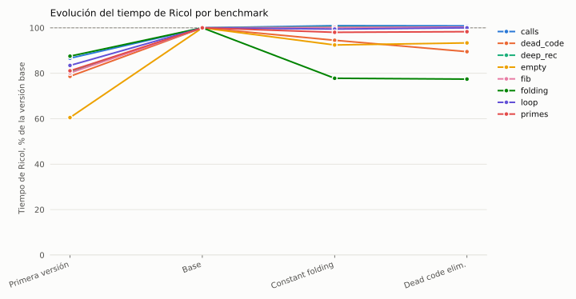

# Resultados de las optimizaciones

Resumen de cómo cambió el rendimiento de Ricol a lo largo de las seis
optimizaciones del implementadas. Las mejoras aplicadas en el optimizador se
explican en [Optimizaciones de Ricol](../../docs/optimizations.md), y las
mejoras del intérprete en el documento de resultados de cada paso, junto con el
detalle de su medición.

## Índice

- [Cómo se midió](#cómo-se-midió)
- [Tiempo de Ricol por versión](#tiempo-de-ricol-por-versión)
- [Aporte de cada optimización](#aporte-de-cada-optimización)
- [Resultado final](#resultado-final)
- [Conclusiones](#conclusiones)
- [Limitaciones](#limitaciones)
- [Mediciones completas](#mediciones-completas)

## Cómo se midió

Cada documento de resultados se midió en el momento de implementar su
optimización, a lo largo de varias horas. Para que la evolución compare
versiones en las mismas condiciones, todas las versiones se volvieron a medir
una detrás de otra:

| Versión | Commit | Documento |
| :--- | :--- | :--- |
| `first_version` | `fb47426` | [Primera versión](results_first_version.md) |
| `baseline` | `27be695` | [Versión base](results_baseline.md) |
| `constant_folding` | `1cd33f6` | [Constant folding](results_constant_folding.md) |
| `dead_code_elimination` | `99fd397` | [Dead code elimination](results_dead_code_elimination.md) |
| `lazy_environments` | `731407f` | [Maps perezosos](results_lazy_environments.md) |
| `node_distances` | `101d5b5` | [Distancia en el nodo](results_node_distances.md) |
| `return_signal` | `2cfffef` | [Return sin `errors.As`](results_return_signal.md) |
| `no_grouping` | `3932ae9` | [Sin agrupaciones](results_no_grouping.md) |

El entorno es el mismo de los demás documentos: Intel(R) Core(TM) Ultra 7 155H
con un núcleo asignado, Linux 7.0.0-43-generic, contenedor Docker con Debian
13, Go 1.27.4, GCC 14.2.0, CPython 3.13.5 y hyperfine 1.19.0, con 2 corridas de
calentamiento y 10 corridas medidas por programa.

Este documento usa solo las mediciones nuevas. Por eso sus números no coinciden
exactamente con los de cada paso, aunque las conclusiones son las mismas.

## Tiempo de Ricol por versión

Tiempo medio de Ricol en ms:

| Benchmark | `first_version` | `baseline` | `constant_folding` | `dead_code_elimination` | `lazy_environments` | `node_distances` | `return_signal` | `no_grouping` |
| :--- | ---: | ---: | ---: | ---: | ---: | ---: | ---: | ---: |
| `calls` | 764.5 | 926.7 | 922.1 | 924.1 | 729.3 | 600.9 | 523.0 | 539.8 |
| `dead_code` | 975.7 | 1294.0 | 1207.0 | 1141.0 | 659.3 | 512.8 | 507.0 | 505.4 |
| `deep_rec` | 2251.0 | 2780.0 | 2764.0 | 2792.0 | 2296.0 | 2036.0 | 1770.0 | 1793.0 |
| `empty` | 0.58 | 0.87 | 0.88 | 0.90 | 0.88 | 0.90 | 0.86 | 0.87 |
| `fib` | 1244.0 | 1536.0 | 1537.0 | 1536.0 | 1179.0 | 1018.0 | 794.7 | 799.2 |
| `folding` | 1183.0 | 1349.0 | 1044.0 | 1043.0 | 712.6 | 646.2 | 637.5 | 636.1 |
| `loop` | 1862.0 | 2229.0 | 2226.0 | 2221.0 | 1512.0 | 1240.0 | 1181.0 | 1193.0 |
| `primes` | 2630.0 | 3188.0 | 3191.0 | 3186.0 | 2189.0 | 1706.0 | 1692.0 | 1710.0 |

## Aporte de cada optimización

Cambio del tiempo de Ricol respecto de la versión anterior, en la misma sesión:

| Versión | `calls` | `dead_code` | `deep_rec` | `empty` | `fib` | `folding` | `loop` | `primes` |
| :--- | ---: | ---: | ---: | ---: | ---: | ---: | ---: | ---: |
| Versión base | +21.2% | +32.6% | +23.5% | +49.9% | +23.5% | +14.0% | +19.7% | +21.2% |
| Constant folding | -0.5% | -6.7% | -0.6% | +0.9% | +0.1% | -22.6% | -0.1% | +0.1% |
| Dead code elimination | +0.2% | -5.5% | +1.0% | +2.1% | -0.1% | -0.1% | -0.2% | -0.2% |
| Maps perezosos | -21.1% | -42.2% | -17.8% | -2.5% | -23.2% | -31.7% | -31.9% | -31.3% |
| Distancia en el nodo | -17.6% | -22.2% | -11.3% | +2.8% | -13.7% | -9.3% | -18.0% | -22.1% |
| Return sin `errors.As` | -13.0% | -1.1% | -13.1% | -4.9% | -21.9% | -1.3% | -4.8% | -0.8% |
| Sin agrupaciones | +3.2% | -0.3% | +1.3% | +2.3% | +0.6% | -0.2% | +1.0% | +1.1% |

Las optimizaciones del intérprete son las que más aportaron, y mejoraron todos
los benchmarks:

- **Maps perezosos** fue, por lejos, la más efectiva: entre 18% y 42%, con un
  cambio de unas 20 líneas. Atacó justo el costo que había hecho más lenta a la
  versión base: entrar a un bloque creaba cuatro maps vacíos.
- **Distancia en el nodo** mejoró entre 9% y 22%, más en los benchmarks que
  usan muchas variables por iteración.
- **Return sin `errors.As`** solo mejoró los benchmarks con llamadas, pero en
  esos fue grande: 22% en `fib` y 13% en `calls` y `deep_rec`.

Las transformaciones del programa (constant folding, dead code elimination y
sin agrupaciones) solo mejoraron los benchmarks que tienen lo que eliminan:
`folding` (-23% con el folding) y `dead_code` (-7% con el folding y -5.5% con
la DCE). En los programas originales, que no tienen expresiones constantes, no
cambiaron nada.

## Resultado final

Contra la [versión base](results_baseline.md), antes de las optimizaciones:

| Benchmark | Versión base | Sin agrupaciones | Cambio | Veces más rápido |
| :--- | ---: | ---: | ---: | ---: |
| `calls` | 926.7 ms | 539.8 ms | -41.8% | 1.7× |
| `dead_code` | 1294.0 ms | 505.4 ms | -60.9% | 2.6× |
| `deep_rec` | 2780.0 ms | 1793.0 ms | -35.5% | 1.6× |
| `empty` | 0.87 ms | 0.87 ms | +0.4% | 1.0× |
| `fib` | 1536.0 ms | 799.2 ms | -48.0% | 1.9× |
| `folding` | 1349.0 ms | 636.1 ms | -52.8% | 2.1× |
| `loop` | 2229.0 ms | 1193.0 ms | -46.5% | 1.9× |
| `primes` | 3188.0 ms | 1710.0 ms | -46.4% | 1.9× |

Ricol es ahora entre 1.6 y 2.6 veces más rápido que antes de las
optimizaciones en todos los benchmarks salvo `empty`, que mide el arranque y
no lo toca ninguna optimización.

Contra la [primera versión](results_first_version.md), que era entre 14% y 33%
más rápida que la versión base, Ricol es ahora entre 20% y 48% más rápido,
salvo en `empty` (+51%), por el tamaño del binario.

Contra Python:

| Benchmark | Primera versión | Versión base | Sin agrupaciones |
| :--- | ---: | ---: | ---: |
| `dead_code` | 4.0× | 5.7× | 2.2× |
| `folding` | 4.4× | 5.1× | 2.4× |
| `loop` | 3.8× | 4.5× | 2.4× |
| `calls` | 5.7× | 7.2× | 4.0× |
| `primes` | 6.9× | 8.4× | 4.5× |
| `deep_rec` | 10.1× | 13.0× | 8.1× |
| `fib` | 14.6× | 18.5× | 9.5× |

Ricol sigue siendo más lento que CPython en todo, pero la distancia se redujo
a la mitad: en los benchmarks de loops, de 4.5 a 5.7 veces a entre 2.2 y 2.4; en
`fib`, de 18.5 veces a 9.5.

## Conclusiones

- **Medir antes de optimizar.** El perfil de la versión base mostró que el
  tiempo no estaba en la aritmética, sino en las estructuras del intérprete:
  crear environments, buscar distancias en un map, detectar el `return`. Las
  tres optimizaciones que atacaron esos puntos dieron casi toda la mejora.
- **Las optimizaciones clásicas de compiladores dependen del programa.**
  Constant folding y dead code elimination solo mejoran código que tiene
  expresiones constantes o ramas muertas. En Ricol, sin constantes ni
  propagación de constantes, eso es poco común, y por eso no mejoraron los
  benchmarks originales.
- **Una funcionalidad nueva puede costar rendimiento en todo el lenguaje.**
  Agregar structs y enums sumó dos maps a cada environment, y eso hizo a la
  versión base entre 14% y 33% más lenta que la primera, incluso en programas
  que no usan ni structs ni enums. Sin benchmarks, esa pérdida habría pasado
  desapercibida.
- **Un costo puede estar escondido.** `errors.As` parecía caro solo en cada
  `return`, pero además hacía que cada sentencia ejecutada dentro de una
  función reservara memoria.

### Dónde se va el tiempo ahora

Según los perfiles de la última versión, lo que más pesa es:

- **La búsqueda de cada variable por nombre** en los maps de strings de su
  environment (alrededor de un 22% de `loop`). Resolver cada variable a una
  posición fija de un arreglo, en vez de a un nombre, la evitaría.
- **Pasar los números a la interfaz `Value`** (alrededor de un 18% de `loop`):
  cada resultado de una operación reserva memoria. Representar los valores de
  otra forma, o reutilizar los números chicos, lo reduciría.
- **Las reservas de memoria de cada llamada** (el environment, el map de los
  parámetros y el `returnSignal`), que en `fib` llevan con el recolector de
  basura cerca de la mitad del tiempo.

El paso más grande sería dejar de recorrer el AST y compilar el programa a
bytecode, como hace CPython, pero es un cambio de arquitectura del intérprete.

## Limitaciones

- Todas las mediciones son de una sola máquina, usando un solo núcleo dentro
  de Docker. Los tiempos absolutos cambian entre máquinas; las proporciones
  entre lenguajes son más estables.
- hyperfine marcó valores atípicos en algunas mediciones de esta sesión: Ricol
  en `empty` y `folding` de la versión base y en `empty` de la distancia en el
  nodo, y Python en `calls`, `dead_code` y `fib` de algunas versiones. Ninguno
  cambia las conclusiones.
- CPython 3.13 corre sin JIT. Con PyPy u otro intérprete con JIT, la
  comparación contra Python cambiaría mucho.

## Mediciones completas

Las tablas de hyperfine de cada versión, en la sesión conjunta:

Primera versión (<code>first_version</code>, commit <code>fb47426</code>)

### calls

| Command | Mean [ms] | Min [ms] | Max [ms] | Relative |
| :--- | ---: | ---: | ---: | ---: |
| `C` | 3.4 ± 0.1 | 3.3 | 3.5 | 1.06 ± 0.03 |
| `Go` | 3.2 ± 0.0 | 3.2 | 3.3 | 1.00 |
| `Python` | 134.6 ± 7.3 | 127.5 | 147.9 | 42.06 ± 2.28 |
| `Ricol` | 764.5 ± 16.5 | 752.7 | 810.3 | 238.91 ± 5.16 |

### dead_code

| Command | Mean [ms] | Min [ms] | Max [ms] | Relative |
| :--- | ---: | ---: | ---: | ---: |
| `C` | 6.1 ± 0.1 | 6.0 | 6.2 | 1.00 |
| `Go` | 6.3 ± 0.1 | 6.2 | 6.5 | 1.03 ± 0.02 |
| `Python` | 245.4 ± 15.7 | 232.2 | 284.2 | 40.23 ± 2.66 |
| `Ricol` | 975.7 ± 5.6 | 969.7 | 986.2 | 159.95 ± 2.78 |

### deep_rec

| Command | Mean [ms] | Min [ms] | Max [ms] | Relative |
| :--- | ---: | ---: | ---: | ---: |
| `C` | 1.0 ± 0.0 | 1.0 | 1.1 | 1.00 |
| `Go` | 2.9 ± 0.1 | 2.8 | 3.0 | 2.90 ± 0.10 |
| `Python` | 223.0 ± 1.2 | 221.2 | 224.3 | 223.00 ± 1.20 |
| `Ricol` | 2251.0 ± 125.0 | 2068.0 | 2391.0 | 2251.00 ± 125.00 |

### empty

| Command | Mean [µs] | Min [µs] | Max [µs] | Relative |
| :--- | ---: | ---: | ---: | ---: |
| `C` | 265.8 ± 6.1 | 257.0 | 277.6 | 1.00 |
| `Go` | 511.5 ± 19.6 | 491.4 | 543.6 | 1.92 ± 0.09 |
| `Python` | 7600.0 ± 100.0 | 7500.0 | 7700.0 | 28.59 ± 0.76 |
| `Ricol` | 581.0 ± 10.2 | 569.7 | 599.4 | 2.19 ± 0.06 |

### fib

| Command | Mean [ms] | Min [ms] | Max [ms] | Relative |
| :--- | ---: | ---: | ---: | ---: |
| `C` | 1.4 ± 0.0 | 1.4 | 1.5 | 1.00 |
| `Go` | 4.2 ± 0.1 | 4.1 | 4.3 | 3.00 ± 0.07 |
| `Python` | 85.2 ± 0.9 | 83.9 | 86.9 | 60.86 ± 0.64 |
| `Ricol` | 1244.0 ± 15.0 | 1228.0 | 1276.0 | 888.57 ± 10.71 |

### folding

| Command | Mean [ms] | Min [ms] | Max [ms] | Relative |
| :--- | ---: | ---: | ---: | ---: |
| `C` | 6.3 ± 0.1 | 6.2 | 6.6 | 1.00 |
| `Go` | 7.3 ± 0.1 | 7.1 | 7.5 | 1.16 ± 0.02 |
| `Python` | 271.4 ± 5.8 | 264.1 | 282.8 | 43.08 ± 1.15 |
| `Ricol` | 1183.0 ± 8.0 | 1170.0 | 1194.0 | 187.78 ± 3.24 |

### loop

| Command | Mean [ms] | Min [ms] | Max [ms] | Relative |
| :--- | ---: | ---: | ---: | ---: |
| `C` | 17.0 ± 0.5 | 16.3 | 17.7 | 1.07 ± 0.04 |
| `Go` | 15.9 ± 0.3 | 15.5 | 16.4 | 1.00 |
| `Python` | 490.8 ± 8.8 | 477.7 | 507.8 | 30.87 ± 0.80 |
| `Ricol` | 1862.0 ± 10.0 | 1839.0 | 1873.0 | 117.11 ± 2.30 |

### primes

| Command | Mean [ms] | Min [ms] | Max [ms] | Relative |
| :--- | ---: | ---: | ---: | ---: |
| `C` | 18.3 ± 0.5 | 17.6 | 19.1 | 1.08 ± 0.04 |
| `Go` | 17.0 ± 0.3 | 16.7 | 17.6 | 1.00 |
| `Python` | 383.0 ± 5.2 | 376.1 | 393.6 | 22.53 ± 0.50 |
| `Ricol` | 2630.0 ± 15.0 | 2614.0 | 2656.0 | 154.71 ± 2.87 |

Versión base (<code>baseline</code>, commit <code>27be695</code>)

### calls

| Command | Mean [ms] | Min [ms] | Max [ms] | Relative |
| :--- | ---: | ---: | ---: | ---: |
| `C` | 3.3 ± 0.0 | 3.3 | 3.3 | 1.03 ± 0.00 |
| `Go` | 3.2 ± 0.0 | 3.2 | 3.3 | 1.00 |
| `Python` | 129.1 ± 3.9 | 124.5 | 136.7 | 40.34 ± 1.22 |
| `Ricol` | 926.7 ± 10.4 | 913.7 | 952.3 | 289.59 ± 3.25 |

### dead_code

| Command | Mean [ms] | Min [ms] | Max [ms] | Relative |
| :--- | ---: | ---: | ---: | ---: |
| `C` | 6.3 ± 0.1 | 6.1 | 6.4 | 1.00 |
| `Go` | 6.3 ± 0.1 | 6.2 | 6.4 | 1.00 ± 0.02 |
| `Python` | 228.6 ± 5.7 | 222.0 | 241.5 | 36.29 ± 1.07 |
| `Ricol` | 1294.0 ± 3.0 | 1291.0 | 1300.0 | 205.40 ± 3.29 |

### deep_rec

| Command | Mean [ms] | Min [ms] | Max [ms] | Relative |
| :--- | ---: | ---: | ---: | ---: |
| `C` | 1.0 ± 0.0 | 0.9 | 1.0 | 1.00 |
| `Go` | 11.4 ± 0.1 | 11.3 | 11.6 | 11.90 ± 0.51 |
| `Python` | 214.6 ± 1.8 | 212.5 | 217.7 | 224.03 ± 9.59 |
| `Ricol` | 2780.0 ± 74.0 | 2630.0 | 2871.0 | 2902.18 ± 144.23 |

### empty

| Command | Mean [µs] | Min [µs] | Max [µs] | Relative |
| :--- | ---: | ---: | ---: | ---: |
| `C` | 248.9 ± 5.3 | 240.1 | 256.8 | 1.00 |
| `Go` | 480.5 ± 8.3 | 467.8 | 495.6 | 1.93 ± 0.05 |
| `Python` | 7100.0 ± 200.0 | 6900.0 | 7600.0 | 28.53 ± 1.01 |
| `Ricol` | 871.1 ± 55.3 | 830.3 | 1009.2 | 3.50 ± 0.23 |

### fib

| Command | Mean [ms] | Min [ms] | Max [ms] | Relative |
| :--- | ---: | ---: | ---: | ---: |
| `C` | 1.3 ± 0.0 | 1.3 | 1.4 | 1.00 |
| `Go` | 4.0 ± 0.1 | 3.9 | 4.3 | 3.08 ± 0.08 |
| `Python` | 83.0 ± 0.6 | 82.0 | 83.8 | 63.85 ± 0.46 |
| `Ricol` | 1536.0 ± 7.0 | 1526.0 | 1545.0 | 1181.54 ± 5.38 |

### folding

| Command | Mean [ms] | Min [ms] | Max [ms] | Relative |
| :--- | ---: | ---: | ---: | ---: |
| `C` | 6.3 ± 0.1 | 6.1 | 6.4 | 1.00 |
| `Go` | 7.3 ± 0.1 | 7.1 | 7.6 | 1.16 ± 0.02 |
| `Python` | 266.5 ± 6.0 | 260.0 | 279.0 | 42.30 ± 1.17 |
| `Ricol` | 1349.0 ± 5.0 | 1338.0 | 1356.0 | 214.13 ± 3.49 |

### loop

| Command | Mean [ms] | Min [ms] | Max [ms] | Relative |
| :--- | ---: | ---: | ---: | ---: |
| `C` | 17.2 ± 0.5 | 16.6 | 18.1 | 1.08 ± 0.04 |
| `Go` | 15.9 ± 0.3 | 15.5 | 16.5 | 1.00 |
| `Python` | 491.0 ± 19.8 | 473.7 | 540.6 | 30.88 ± 1.37 |
| `Ricol` | 2229.0 ± 9.0 | 2215.0 | 2245.0 | 140.19 ± 2.70 |

### primes

| Command | Mean [ms] | Min [ms] | Max [ms] | Relative |
| :--- | ---: | ---: | ---: | ---: |
| `C` | 18.3 ± 0.6 | 17.5 | 19.4 | 1.08 ± 0.04 |
| `Go` | 17.0 ± 0.3 | 16.6 | 17.5 | 1.00 |
| `Python` | 380.2 ± 3.9 | 375.3 | 389.8 | 22.36 ± 0.46 |
| `Ricol` | 3188.0 ± 8.0 | 3176.0 | 3197.0 | 187.53 ± 3.34 |

Constant folding (<code>constant_folding</code>, commit <code>1cd33f6</code>)

### calls

| Command | Mean [ms] | Min [ms] | Max [ms] | Relative |
| :--- | ---: | ---: | ---: | ---: |
| `C` | 3.3 ± 0.0 | 3.3 | 3.4 | 1.03 ± 0.00 |
| `Go` | 3.2 ± 0.0 | 3.1 | 3.3 | 1.00 |
| `Python` | 132.0 ± 9.4 | 124.1 | 151.8 | 41.25 ± 2.94 |
| `Ricol` | 922.1 ± 13.4 | 909.3 | 957.4 | 288.16 ± 4.19 |

### dead_code

| Command | Mean [ms] | Min [ms] | Max [ms] | Relative |
| :--- | ---: | ---: | ---: | ---: |
| `C` | 6.1 ± 0.1 | 6.0 | 6.2 | 1.00 |
| `Go` | 6.3 ± 0.1 | 6.2 | 6.5 | 1.03 ± 0.02 |
| `Python` | 225.6 ± 5.1 | 220.3 | 236.3 | 36.98 ± 1.03 |
| `Ricol` | 1207.0 ± 4.0 | 1202.0 | 1214.0 | 197.87 ± 3.31 |

### deep_rec

| Command | Mean [ms] | Min [ms] | Max [ms] | Relative |
| :--- | ---: | ---: | ---: | ---: |
| `C` | 1.0 ± 0.0 | 0.9 | 1.0 | 1.00 |
| `Go` | 11.4 ± 0.4 | 10.9 | 12.2 | 11.88 ± 0.59 |
| `Python` | 214.7 ± 1.8 | 212.9 | 218.4 | 223.81 ± 8.17 |
| `Ricol` | 2764.0 ± 77.0 | 2655.0 | 2932.0 | 2881.27 ± 130.13 |

### empty

| Command | Mean [µs] | Min [µs] | Max [µs] | Relative |
| :--- | ---: | ---: | ---: | ---: |
| `C` | 248.1 ± 5.2 | 242.5 | 260.7 | 1.00 |
| `Go` | 486.5 ± 41.6 | 452.6 | 556.6 | 1.96 ± 0.17 |
| `Python` | 7100.0 ± 0.0 | 7000.0 | 7200.0 | 28.62 ± 0.60 |
| `Ricol` | 879.3 ± 48.3 | 838.8 | 998.6 | 3.54 ± 0.21 |

### fib

| Command | Mean [ms] | Min [ms] | Max [ms] | Relative |
| :--- | ---: | ---: | ---: | ---: |
| `C` | 1.4 ± 0.0 | 1.4 | 1.4 | 1.00 |
| `Go` | 4.0 ± 0.0 | 3.9 | 4.0 | 2.86 ± 0.00 |
| `Python` | 82.5 ± 1.1 | 81.0 | 84.1 | 58.93 ± 0.79 |
| `Ricol` | 1537.0 ± 6.0 | 1528.0 | 1547.0 | 1097.86 ± 4.29 |

### folding

| Command | Mean [ms] | Min [ms] | Max [ms] | Relative |
| :--- | ---: | ---: | ---: | ---: |
| `C` | 6.1 ± 0.1 | 6.0 | 6.2 | 1.00 |
| `Go` | 7.3 ± 0.1 | 7.1 | 7.4 | 1.20 ± 0.03 |
| `Python` | 266.8 ± 7.3 | 261.4 | 286.6 | 43.74 ± 1.40 |
| `Ricol` | 1044.0 ± 5.0 | 1038.0 | 1051.0 | 171.15 ± 2.92 |

### loop

| Command | Mean [ms] | Min [ms] | Max [ms] | Relative |
| :--- | ---: | ---: | ---: | ---: |
| `C` | 16.9 ± 0.5 | 16.3 | 17.6 | 1.06 ± 0.04 |
| `Go` | 15.9 ± 0.3 | 15.5 | 16.2 | 1.00 |
| `Python` | 490.3 ± 16.3 | 475.4 | 523.4 | 30.84 ± 1.18 |
| `Ricol` | 2226.0 ± 10.0 | 2204.0 | 2239.0 | 140.00 ± 2.72 |

### primes

| Command | Mean [ms] | Min [ms] | Max [ms] | Relative |
| :--- | ---: | ---: | ---: | ---: |
| `C` | 18.4 ± 0.6 | 17.6 | 19.3 | 1.08 ± 0.04 |
| `Go` | 17.1 ± 0.3 | 16.6 | 17.7 | 1.00 |
| `Python` | 379.3 ± 3.4 | 375.0 | 385.7 | 22.18 ± 0.44 |
| `Ricol` | 3191.0 ± 8.0 | 3184.0 | 3208.0 | 186.61 ± 3.31 |

Dead code elimination (<code>dead_code_elimination</code>, commit <code>99fd397</code>)

### calls

| Command | Mean [ms] | Min [ms] | Max [ms] | Relative |
| :--- | ---: | ---: | ---: | ---: |
| `C` | 3.3 ± 0.0 | 3.3 | 3.4 | 1.03 ± 0.00 |
| `Go` | 3.2 ± 0.0 | 3.1 | 3.2 | 1.00 |
| `Python` | 129.9 ± 3.0 | 124.7 | 133.3 | 40.59 ± 0.94 |
| `Ricol` | 924.1 ± 10.8 | 907.0 | 938.6 | 288.78 ± 3.38 |

### dead_code

| Command | Mean [ms] | Min [ms] | Max [ms] | Relative |
| :--- | ---: | ---: | ---: | ---: |
| `C` | 6.1 ± 0.1 | 6.0 | 6.3 | 1.00 |
| `Go` | 6.3 ± 0.1 | 6.1 | 6.5 | 1.03 ± 0.02 |
| `Python` | 227.1 ± 5.4 | 220.4 | 238.7 | 37.23 ± 1.08 |
| `Ricol` | 1141.0 ± 6.0 | 1128.0 | 1148.0 | 187.05 ± 3.22 |

### deep_rec

| Command | Mean [ms] | Min [ms] | Max [ms] | Relative |
| :--- | ---: | ---: | ---: | ---: |
| `C` | 0.9 ± 0.0 | 0.9 | 1.0 | 1.00 |
| `Go` | 11.6 ± 0.3 | 11.3 | 12.3 | 12.38 ± 0.37 |
| `Python` | 215.6 ± 2.2 | 212.5 | 219.1 | 230.05 ± 4.10 |
| `Ricol` | 2792.0 ± 39.0 | 2722.0 | 2852.0 | 2979.09 ± 60.23 |

### empty

| Command | Mean [µs] | Min [µs] | Max [µs] | Relative |
| :--- | ---: | ---: | ---: | ---: |
| `C` | 264.9 ± 24.9 | 243.9 | 315.7 | 1.00 |
| `Go` | 496.0 ± 35.8 | 467.6 | 591.0 | 1.87 ± 0.22 |
| `Python` | 7100.0 ± 0.0 | 7000.0 | 7100.0 | 26.80 ± 2.52 |
| `Ricol` | 897.5 ± 32.3 | 873.8 | 977.7 | 3.39 ± 0.34 |

### fib

| Command | Mean [ms] | Min [ms] | Max [ms] | Relative |
| :--- | ---: | ---: | ---: | ---: |
| `C` | 1.3 ± 0.0 | 1.3 | 1.4 | 1.00 |
| `Go` | 3.9 ± 0.0 | 3.9 | 4.0 | 3.00 ± 0.00 |
| `Python` | 82.6 ± 1.6 | 81.5 | 87.0 | 63.54 ± 1.23 |
| `Ricol` | 1536.0 ± 7.0 | 1527.0 | 1551.0 | 1181.54 ± 5.38 |

### folding

| Command | Mean [ms] | Min [ms] | Max [ms] | Relative |
| :--- | ---: | ---: | ---: | ---: |
| `C` | 6.3 ± 0.2 | 6.2 | 6.7 | 1.00 |
| `Go` | 7.3 ± 0.1 | 7.1 | 7.3 | 1.16 ± 0.04 |
| `Python` | 265.5 ± 3.0 | 260.9 | 269.7 | 42.14 ± 1.42 |
| `Ricol` | 1043.0 ± 5.0 | 1033.0 | 1050.0 | 165.56 ± 5.32 |

### loop

| Command | Mean [ms] | Min [ms] | Max [ms] | Relative |
| :--- | ---: | ---: | ---: | ---: |
| `C` | 17.1 ± 0.5 | 16.4 | 18.0 | 1.08 ± 0.04 |
| `Go` | 15.9 ± 0.4 | 15.5 | 16.5 | 1.00 |
| `Python` | 487.0 ± 9.1 | 473.6 | 502.7 | 30.63 ± 0.96 |
| `Ricol` | 2221.0 ± 6.0 | 2209.0 | 2228.0 | 139.69 ± 3.53 |

### primes

| Command | Mean [ms] | Min [ms] | Max [ms] | Relative |
| :--- | ---: | ---: | ---: | ---: |
| `C` | 18.4 ± 0.5 | 17.5 | 19.3 | 1.09 ± 0.04 |
| `Go` | 16.9 ± 0.3 | 16.6 | 17.5 | 1.00 |
| `Python` | 381.3 ± 5.6 | 374.7 | 395.0 | 22.56 ± 0.52 |
| `Ricol` | 3186.0 ± 11.0 | 3173.0 | 3203.0 | 188.52 ± 3.41 |

Maps perezosos (<code>lazy_environments</code>, commit <code>731407f</code>)

### calls

| Command | Mean [ms] | Min [ms] | Max [ms] | Relative |
| :--- | ---: | ---: | ---: | ---: |
| `C` | 3.3 ± 0.0 | 3.3 | 3.4 | 1.03 ± 0.00 |
| `Go` | 3.2 ± 0.0 | 3.2 | 3.3 | 1.00 |
| `Python` | 132.0 ± 7.5 | 124.4 | 143.5 | 41.25 ± 2.34 |
| `Ricol` | 729.3 ± 8.0 | 718.9 | 747.2 | 227.91 ± 2.50 |

### dead_code

| Command | Mean [ms] | Min [ms] | Max [ms] | Relative |
| :--- | ---: | ---: | ---: | ---: |
| `C` | 5.9 ± 0.0 | 5.8 | 5.9 | 1.00 |
| `Go` | 6.1 ± 0.2 | 6.0 | 6.5 | 1.03 ± 0.03 |
| `Python` | 226.0 ± 5.0 | 221.9 | 237.4 | 38.31 ± 0.85 |
| `Ricol` | 659.3 ± 2.8 | 654.6 | 663.4 | 111.75 ± 0.47 |

### deep_rec

| Command | Mean [ms] | Min [ms] | Max [ms] | Relative |
| :--- | ---: | ---: | ---: | ---: |
| `C` | 0.9 ± 0.0 | 0.9 | 1.0 | 1.00 |
| `Go` | 11.4 ± 0.3 | 10.9 | 11.7 | 12.13 ± 0.51 |
| `Python` | 215.2 ± 1.1 | 213.5 | 216.9 | 228.96 ± 7.64 |
| `Ricol` | 2296.0 ± 57.0 | 2203.0 | 2406.0 | 2442.81 ± 100.84 |

### empty

| Command | Mean [µs] | Min [µs] | Max [µs] | Relative |
| :--- | ---: | ---: | ---: | ---: |
| `C` | 265.5 ± 21.1 | 245.7 | 314.5 | 1.00 |
| `Go` | 472.1 ± 13.7 | 450.7 | 497.8 | 1.78 ± 0.15 |
| `Python` | 7200.0 ± 200.0 | 7000.0 | 7500.0 | 27.12 ± 2.28 |
| `Ricol` | 875.1 ± 52.9 | 839.7 | 1003.8 | 3.30 ± 0.33 |

### fib

| Command | Mean [ms] | Min [ms] | Max [ms] | Relative |
| :--- | ---: | ---: | ---: | ---: |
| `C` | 1.4 ± 0.0 | 1.3 | 1.4 | 1.00 |
| `Go` | 4.0 ± 0.0 | 3.9 | 4.1 | 2.86 ± 0.00 |
| `Python` | 83.1 ± 1.9 | 81.1 | 86.1 | 59.36 ± 1.36 |
| `Ricol` | 1179.0 ± 12.0 | 1156.0 | 1197.0 | 842.14 ± 8.57 |

### folding

| Command | Mean [ms] | Min [ms] | Max [ms] | Relative |
| :--- | ---: | ---: | ---: | ---: |
| `C` | 6.5 ± 0.1 | 6.4 | 6.6 | 1.00 |
| `Go` | 7.6 ± 0.1 | 7.3 | 7.7 | 1.17 ± 0.02 |
| `Python` | 270.8 ± 3.6 | 265.7 | 276.5 | 41.66 ± 0.85 |
| `Ricol` | 712.6 ± 8.7 | 701.8 | 730.2 | 109.63 ± 2.15 |

### loop

| Command | Mean [ms] | Min [ms] | Max [ms] | Relative |
| :--- | ---: | ---: | ---: | ---: |
| `C` | 16.9 ± 0.4 | 16.3 | 17.5 | 1.06 ± 0.03 |
| `Go` | 15.9 ± 0.3 | 15.6 | 16.5 | 1.00 |
| `Python` | 489.3 ± 10.8 | 478.0 | 508.3 | 30.77 ± 0.89 |
| `Ricol` | 1512.0 ± 10.0 | 1496.0 | 1527.0 | 95.09 ± 1.90 |

### primes

| Command | Mean [ms] | Min [ms] | Max [ms] | Relative |
| :--- | ---: | ---: | ---: | ---: |
| `C` | 17.8 ± 0.4 | 17.2 | 18.4 | 1.05 ± 0.03 |
| `Go` | 16.9 ± 0.3 | 16.6 | 17.5 | 1.00 |
| `Python` | 380.0 ± 3.7 | 374.2 | 385.2 | 22.49 ± 0.46 |
| `Ricol` | 2189.0 ± 9.0 | 2169.0 | 2200.0 | 129.53 ± 2.36 |

Distancia en el nodo (<code>node_distances</code>, commit <code>101d5b5</code>)

### calls

| Command | Mean [ms] | Min [ms] | Max [ms] | Relative |
| :--- | ---: | ---: | ---: | ---: |
| `C` | 3.3 ± 0.0 | 3.3 | 3.4 | 1.03 ± 0.00 |
| `Go` | 3.2 ± 0.0 | 3.2 | 3.2 | 1.00 |
| `Python` | 131.5 ± 8.3 | 124.7 | 154.5 | 41.09 ± 2.59 |
| `Ricol` | 600.9 ± 5.3 | 592.1 | 610.7 | 187.78 ± 1.66 |

### dead_code

| Command | Mean [ms] | Min [ms] | Max [ms] | Relative |
| :--- | ---: | ---: | ---: | ---: |
| `C` | 6.1 ± 0.1 | 6.0 | 6.3 | 1.00 |
| `Go` | 6.1 ± 0.1 | 6.0 | 6.2 | 1.00 ± 0.02 |
| `Python` | 228.1 ± 8.8 | 220.1 | 250.6 | 37.39 ± 1.57 |
| `Ricol` | 512.8 ± 2.5 | 510.0 | 516.5 | 84.07 ± 1.44 |

### deep_rec

| Command | Mean [ms] | Min [ms] | Max [ms] | Relative |
| :--- | ---: | ---: | ---: | ---: |
| `C` | 0.9 ± 0.0 | 0.9 | 1.0 | 1.00 |
| `Go` | 11.2 ± 0.3 | 10.9 | 11.8 | 12.25 ± 0.52 |
| `Python` | 213.3 ± 1.3 | 211.8 | 215.9 | 233.27 ± 7.86 |
| `Ricol` | 2036.0 ± 41.0 | 1962.0 | 2093.0 | 2226.60 ± 86.34 |

### empty

| Command | Mean [µs] | Min [µs] | Max [µs] | Relative |
| :--- | ---: | ---: | ---: | ---: |
| `C` | 264.5 ± 24.0 | 244.6 | 323.0 | 1.00 |
| `Go` | 480.3 ± 16.2 | 456.3 | 508.3 | 1.82 ± 0.18 |
| `Python` | 7100.0 ± 100.0 | 7000.0 | 7500.0 | 26.84 ± 2.46 |
| `Ricol` | 899.3 ± 63.1 | 836.8 | 1014.9 | 3.40 ± 0.39 |

### fib

| Command | Mean [ms] | Min [ms] | Max [ms] | Relative |
| :--- | ---: | ---: | ---: | ---: |
| `C` | 1.4 ± 0.0 | 1.4 | 1.5 | 1.00 |
| `Go` | 4.0 ± 0.1 | 4.0 | 4.2 | 2.86 ± 0.07 |
| `Python` | 82.3 ± 0.9 | 81.0 | 84.1 | 58.79 ± 0.64 |
| `Ricol` | 1018.0 ± 3.0 | 1012.0 | 1021.0 | 727.14 ± 2.14 |

### folding

| Command | Mean [ms] | Min [ms] | Max [ms] | Relative |
| :--- | ---: | ---: | ---: | ---: |
| `C` | 6.2 ± 0.1 | 6.0 | 6.4 | 1.00 |
| `Go` | 7.2 ± 0.1 | 7.0 | 7.3 | 1.16 ± 0.02 |
| `Python` | 265.7 ± 4.0 | 258.8 | 271.1 | 42.85 ± 0.95 |
| `Ricol` | 646.2 ± 7.2 | 639.2 | 661.3 | 104.23 ± 2.04 |

### loop

| Command | Mean [ms] | Min [ms] | Max [ms] | Relative |
| :--- | ---: | ---: | ---: | ---: |
| `C` | 16.8 ± 0.5 | 16.1 | 17.6 | 1.06 ± 0.04 |
| `Go` | 15.9 ± 0.3 | 15.5 | 16.3 | 1.00 |
| `Python` | 484.1 ± 9.8 | 473.9 | 504.9 | 30.45 ± 0.84 |
| `Ricol` | 1240.0 ± 7.0 | 1229.0 | 1253.0 | 77.99 ± 1.54 |

### primes

| Command | Mean [ms] | Min [ms] | Max [ms] | Relative |
| :--- | ---: | ---: | ---: | ---: |
| `C` | 17.6 ± 0.3 | 17.1 | 18.0 | 1.05 ± 0.02 |
| `Go` | 16.8 ± 0.2 | 16.6 | 17.2 | 1.00 |
| `Python` | 376.2 ± 3.4 | 372.6 | 384.6 | 22.39 ± 0.33 |
| `Ricol` | 1706.0 ± 7.0 | 1695.0 | 1718.0 | 101.55 ± 1.28 |

Return sin `errors.As` (<code>return_signal</code>, commit <code>2cfffef</code>)

### calls

| Command | Mean [ms] | Min [ms] | Max [ms] | Relative |
| :--- | ---: | ---: | ---: | ---: |
| `C` | 3.3 ± 0.0 | 3.3 | 3.4 | 1.03 ± 0.00 |
| `Go` | 3.2 ± 0.0 | 3.1 | 3.2 | 1.00 |
| `Python` | 129.1 ± 4.8 | 124.3 | 136.6 | 40.34 ± 1.50 |
| `Ricol` | 523.0 ± 2.8 | 518.9 | 528.3 | 163.44 ± 0.87 |

### dead_code

| Command | Mean [ms] | Min [ms] | Max [ms] | Relative |
| :--- | ---: | ---: | ---: | ---: |
| `C` | 5.5 ± 0.0 | 5.5 | 5.5 | 1.00 |
| `Go` | 5.8 ± 0.1 | 5.7 | 6.0 | 1.05 ± 0.02 |
| `Python` | 231.0 ± 10.0 | 220.6 | 247.9 | 42.00 ± 1.82 |
| `Ricol` | 507.0 ± 2.5 | 502.9 | 510.3 | 92.18 ± 0.45 |

### deep_rec

| Command | Mean [ms] | Min [ms] | Max [ms] | Relative |
| :--- | ---: | ---: | ---: | ---: |
| `C` | 0.9 ± 0.0 | 0.9 | 1.0 | 1.00 |
| `Go` | 11.1 ± 0.2 | 10.9 | 11.5 | 12.15 ± 0.42 |
| `Python` | 215.5 ± 4.8 | 211.5 | 227.1 | 235.93 ± 8.79 |
| `Ricol` | 1770.0 ± 32.0 | 1723.0 | 1826.0 | 1937.81 ± 67.69 |

### empty

| Command | Mean [µs] | Min [µs] | Max [µs] | Relative |
| :--- | ---: | ---: | ---: | ---: |
| `C` | 245.5 ± 10.6 | 232.3 | 262.8 | 1.00 |
| `Go` | 478.2 ± 32.9 | 448.5 | 550.7 | 1.95 ± 0.16 |
| `Python` | 7100.0 ± 100.0 | 7000.0 | 7500.0 | 28.92 ± 1.31 |
| `Ricol` | 855.5 ± 52.6 | 813.3 | 956.0 | 3.48 ± 0.26 |

### fib

| Command | Mean [ms] | Min [ms] | Max [ms] | Relative |
| :--- | ---: | ---: | ---: | ---: |
| `C` | 1.4 ± 0.1 | 1.3 | 1.6 | 1.00 |
| `Go` | 3.9 ± 0.0 | 3.8 | 3.9 | 2.79 ± 0.20 |
| `Python` | 83.2 ± 1.2 | 81.7 | 84.8 | 59.43 ± 4.33 |
| `Ricol` | 794.7 ± 3.7 | 787.6 | 799.7 | 567.64 ± 40.63 |

### folding

| Command | Mean [ms] | Min [ms] | Max [ms] | Relative |
| :--- | ---: | ---: | ---: | ---: |
| `C` | 6.2 ± 0.1 | 6.0 | 6.3 | 1.00 |
| `Go` | 7.2 ± 0.1 | 7.1 | 7.4 | 1.16 ± 0.02 |
| `Python` | 264.7 ± 3.4 | 259.1 | 269.4 | 42.69 ± 0.88 |
| `Ricol` | 637.5 ± 3.8 | 632.0 | 644.5 | 102.82 ± 1.77 |

### loop

| Command | Mean [ms] | Min [ms] | Max [ms] | Relative |
| :--- | ---: | ---: | ---: | ---: |
| `C` | 16.0 ± 0.3 | 15.6 | 16.7 | 1.02 ± 0.02 |
| `Go` | 15.7 ± 0.1 | 15.6 | 15.9 | 1.00 |
| `Python` | 486.9 ± 11.0 | 475.0 | 506.8 | 31.01 ± 0.73 |
| `Ricol` | 1181.0 ± 10.0 | 1170.0 | 1207.0 | 75.22 ± 0.80 |

### primes

| Command | Mean [ms] | Min [ms] | Max [ms] | Relative |
| :--- | ---: | ---: | ---: | ---: |
| `C` | 17.6 ± 0.5 | 16.9 | 18.4 | 1.05 ± 0.03 |
| `Go` | 16.8 ± 0.2 | 16.6 | 17.1 | 1.00 |
| `Python` | 378.5 ± 3.6 | 373.4 | 385.5 | 22.53 ± 0.34 |
| `Ricol` | 1692.0 ± 12.0 | 1677.0 | 1711.0 | 100.71 ± 1.40 |

Sin agrupaciones (<code>no_grouping</code>, commit <code>3932ae9</code>)

### calls

| Command | Mean [ms] | Min [ms] | Max [ms] | Relative |
| :--- | ---: | ---: | ---: | ---: |
| `C` | 3.3 ± 0.0 | 3.3 | 3.4 | 1.03 ± 0.00 |
| `Go` | 3.2 ± 0.0 | 3.2 | 3.3 | 1.00 |
| `Python` | 133.6 ± 5.9 | 127.2 | 143.8 | 41.75 ± 1.84 |
| `Ricol` | 539.8 ± 16.2 | 522.8 | 571.9 | 168.69 ± 5.06 |

### dead_code

| Command | Mean [ms] | Min [ms] | Max [ms] | Relative |
| :--- | ---: | ---: | ---: | ---: |
| `C` | 6.3 ± 0.1 | 6.2 | 6.5 | 1.00 |
| `Go` | 6.4 ± 0.1 | 6.3 | 6.5 | 1.02 ± 0.02 |
| `Python` | 234.5 ± 4.3 | 228.3 | 243.0 | 37.22 ± 0.90 |
| `Ricol` | 505.4 ± 2.5 | 502.1 | 509.9 | 80.22 ± 1.33 |

### deep_rec

| Command | Mean [ms] | Min [ms] | Max [ms] | Relative |
| :--- | ---: | ---: | ---: | ---: |
| `C` | 0.9 ± 0.0 | 0.9 | 1.0 | 1.00 |
| `Go` | 11.3 ± 0.3 | 10.9 | 11.6 | 12.37 ± 0.47 |
| `Python` | 221.1 ± 4.8 | 217.3 | 232.1 | 242.04 ± 8.41 |
| `Ricol` | 1793.0 ± 27.0 | 1750.0 | 1836.0 | 1962.78 ± 60.93 |

### empty

| Command | Mean [µs] | Min [µs] | Max [µs] | Relative |
| :--- | ---: | ---: | ---: | ---: |
| `C` | 268.6 ± 28.3 | 241.2 | 338.6 | 1.00 |
| `Go` | 496.1 ± 28.3 | 452.7 | 543.6 | 1.85 ± 0.22 |
| `Python` | 7200.0 ± 100.0 | 7000.0 | 7400.0 | 26.81 ± 2.85 |
| `Ricol` | 874.9 ± 53.1 | 835.2 | 979.9 | 3.26 ± 0.40 |

### fib

| Command | Mean [ms] | Min [ms] | Max [ms] | Relative |
| :--- | ---: | ---: | ---: | ---: |
| `C` | 1.4 ± 0.1 | 1.4 | 1.6 | 1.00 |
| `Go` | 4.0 ± 0.1 | 3.9 | 4.2 | 2.86 ± 0.22 |
| `Python` | 84.4 ± 1.0 | 82.5 | 86.2 | 60.29 ± 4.36 |
| `Ricol` | 799.2 ± 5.0 | 791.7 | 807.4 | 570.86 ± 40.93 |

### folding

| Command | Mean [ms] | Min [ms] | Max [ms] | Relative |
| :--- | ---: | ---: | ---: | ---: |
| `C` | 6.2 ± 0.1 | 6.0 | 6.3 | 1.00 |
| `Go` | 7.2 ± 0.1 | 7.1 | 7.4 | 1.16 ± 0.02 |
| `Python` | 270.2 ± 4.1 | 264.1 | 277.9 | 43.58 ± 0.97 |
| `Ricol` | 636.1 ± 4.5 | 630.9 | 646.2 | 102.60 ± 1.81 |

### loop

| Command | Mean [ms] | Min [ms] | Max [ms] | Relative |
| :--- | ---: | ---: | ---: | ---: |
| `C` | 16.5 ± 0.4 | 15.9 | 17.2 | 1.04 ± 0.03 |
| `Go` | 15.8 ± 0.2 | 15.6 | 16.1 | 1.00 |
| `Python` | 505.1 ± 20.4 | 481.6 | 542.7 | 31.97 ± 1.35 |
| `Ricol` | 1193.0 ± 4.0 | 1187.0 | 1199.0 | 75.51 ± 0.99 |

### primes

| Command | Mean [ms] | Min [ms] | Max [ms] | Relative |
| :--- | ---: | ---: | ---: | ---: |
| `C` | 17.8 ± 0.4 | 17.1 | 18.5 | 1.06 ± 0.03 |
| `Go` | 16.8 ± 0.2 | 16.6 | 17.2 | 1.00 |
| `Python` | 383.3 ± 3.5 | 377.9 | 390.0 | 22.82 ± 0.34 |
| `Ricol` | 1710.0 ± 9.0 | 1698.0 | 1724.0 | 101.79 ± 1.32 |

